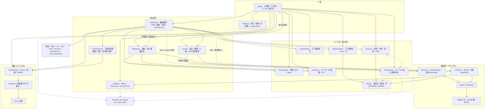
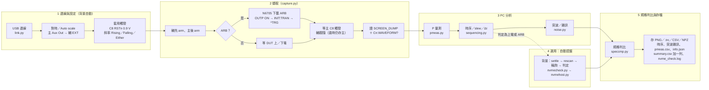
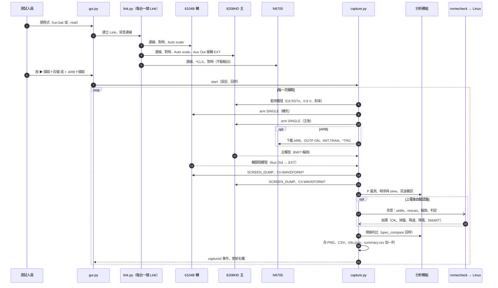

# 8208-6104 Remote Console（ScopeWaveSaver）

中控電腦上的雙示波器遠端工具：主 **Teledyne LeCroy WaveRunner 8208HD（MASTER，8 CH）** ＋ 輔 **HDO6104B（SLAVE，4 CH）**。
設定觸發與 bus name、P1–P24 量測，連線後在背景自動對時、Auto scale，並把主 **Aux Out → 輔 EXT** 設成主從觸發（不用 10 MHz 同步）。兩台 **SCREEN_DUMP 實圖**上下無縫接合顯示，波形與量測存到中控電腦。

電源方面接 Keysight **N6705**，用一套共用的參數式 ARB 範本（Ramp／Brownout margin／Instant ON-OFF-ON）套到**一個**選中的輸出通道（CH1／CH3 選擇，**預設 CH3 VIN**；CH2／CH4 在進階）。選用 Linux SSH 做 NVMe rescan；U.2／M.2 電源設計表可與實測做判比。

> **目前狀態：預設為示範模式**（模擬示波器 `SimScope` ＋ 模擬 N6705 `SimN6705`）。連續擷取、上／下電時序、USB 重連、ARB＋擷取都已在示範模式跑過；畫面上的示波器圖是 **PLACEHOLDER 示意圖**。加 `--real` 才走 USB VISA 接實機，**尚未實機測試**。

> **📘 操作手冊（圖文版，給測試人員）：[docs/操作手冊.md](docs/操作手冊.md)　｜　[PDF](docs/操作手冊.pdf)**
> 安裝與啟動、畫面總覽（編號標註）、儀器接線、每個功能的步驟流程、輸出檔案說明與常見問題。


## 架構圖

### 1. 模組與資料流

箭頭＝實際的 `import`／呼叫（已對照程式碼）；虛線＝延遲載入或回呼。



資料流摘要：`gui.py` 為每台儀器建立 `link.Link`（裡面包 `LeCroyScope`／`N6705`，示範模式換成 `SimScope`／`SimN6705`），連線、對時、Auto scale 與重連都在背景。擷取流程在 `capture.py`：先輔 arm、再主 arm，ARB 時再叫 N6705 啟動，等主觸發後讀波形，交給 `pmeas`／`sequencing`／`noise` 在 PC 計算；規格判比由 GUI 以回呼（`spec_compare`）交給 `speccmp`（它會用到 `noise` 的結果）。Linux NVMe 是選用路徑，未勾選時不連線、也**不 import paramiko**；「上電後自動 rescan」由 `capture.py` 在上電事件後交給 `nvmecheck.py` 在背景執行緒判定，不卡畫面。版型與電源設計表優先使用 Autotest_tool 的 `u2core`（`U2_TOOL_DIR`），沒有時改用隨附 `specs/`。

### 2. 一次擷取的流程（連線 → 設定 → 觸發 RSTn → 擷取 → 分析 → 認盤 → 存檔）



### 3. 擷取時序圖（誰在什麼時候做什麼）



## 儀器與通道

| 角色 | 機型 | 硬體通道（寫入示波器的對應不變） |
|---|---|---|
| MASTER | WaveRunner 8208HD | C1–C8 = CORE、DDRVPP、GPIO、DDRIO、PHYIO、NFIO、NFCORE、RSTn |
| SLAVE | HDO6104B | C1 VIN、C2 VBUS、C3 BUSPG、C4 IBUS（電流，單位 A） |

列表列序（時序表／圖／時序 CSV、⑨ 規格表、合一張圖例、`summary.csv` 欄位、P 量測列表）是 **輔機訊號在前**：VIN、VBUS、IBUS、BUSPG，再主機 CORE…RSTn。時序「順序」欄仍依上／下電發生時間編號（相對參考 rail，預設 VIN）。示波器端 P 編號不變（8208HD P1–P12、6104B P1–P8；其餘 P 在 PC 計算）。

主觸發預設 **C8 RSTn、準位 0.9 V**（50% × 1.8 V）；斜率 Rising／Falling／Either。換 ARB 範本時斜率會跟著改（Ramp = Rising，Brownout／ON-OFF-ON = Falling），仍可手動改。輔機由主 Aux Out（Trigger Out）經 BNC 接到 EXT（EX10、0.5 V、Rising），連線後背景自動設定。

## 主要功能

**① 儀器連線** — 單列狀態條（色點 ＋ 8208HD／6104B／N6705；啟用 NVMe 時加 Linux 主機）。開程式自動連線；VISA 位址收在 ⚙。對時與 Auto scale 在背景做，只寫紀錄；失敗或斷線才顯示紅字。

**② 觸發** — 來源／準位／斜率／模式、T/div、Delay。主從同步固定寫入，UI 不另顯示，失敗才提示。

**③ 通道 ＋ bus name** — 寫入示波器 Alias／Label（ASCII）。

**④ P1–P24** — 每列標「示波器」或「PC 計算」。超過該台 P／數學通道上限，或型號不支援的參數，不送示波器，改用同一筆波形在 PC 算，寫入前會提醒。

| | WaveRunner 8208HD | HDO6104B |
|---|---|---|
| 示波器量測 P | P1–P12 | P1–P8 |
| 數學通道（V×I 用 Product） | F1–F12 | F1–F8 |
| 參數（兩台 datasheet 都有） | Max、Min、Mean、PkPk、Rise、Fall、Width、Frequency、Delay、Δ Time@level | 同左 |
| 實機確認（Autotest_tool） | Rise、Fall、Max、Min、Mean、PkPk、Delay | 尚無紀錄 |

**⑤ 存檔** — 預設 `桌面\scope waveform\<前綴>_<日期時間>\`。可存上下接合 PNG、兩台原始實圖、.trc／CSV／NPZ、P 量測 CSV、時序 CSV＋PNG、`info.json`。格線區先自動偵測，偵測不到改用 `composite.GRID_FRAC`（實機 MAUI 畫面位置待確認）。

**⑥ 連續擷取** — 觸發次數 N（0 = 直到 ■ 停止）、等觸發逾時。每次一個序號子資料夾，外加跨次數的 `summary.csv`。流程：輔先 arm → 主再 arm → 等主觸發 → 等輔跟隨（逾時仍存主的，並記錄提醒檢查 BNC）。

**⑦ 上／下電時序 ＋ slew rate（PC 計算）** — 用存下來的波形（共同時間軸，t = 0 = 主觸發）。可自動判斷上電或下電。電壓轨報 10↔90% 時間與 slew（V/ms）；RSTn／BUSPG 用邏輯門檻（預設 0.7 × 標稱）；IBUS 報峰值與 A/ms。可選每條 rail 的上／下電延遲上下限 → PASS／FAIL。ARB 每次擷取也走同一套時序（含 slew 與對參考的 Δt）。

**USB 自動重連（`link.py`）** — VISA 錯誤或逾時標成斷線並背景重試（退避 1–30 s）；重連後先重做背景設定。閒置每 3 s 心跳。連續擷取中斷線會暫停，重連後重做該序號。示範可用 `--unplug 6104B:4@3` 或 ⚙ 裡的「模擬拔 USB」。

**⑧ N6705 ARB** — 一套共用範本，一次只套一個通道（預設 CH3 VIN；選 U.2 時標稱 12 V，選 M.2 時 3.3 V）：

| 範本 | 重點參數 | 下載成 |
|---|---|---|
| Ramp | 起始／結束 V、延遲、上升、停留、下降、結束停留、重複 | 原生 Trapezoid |
| Brownout margin | 標稱、掉到（V 或 %，可掃描例如 `-5%/-10%/-20%`）、時間與重複 | 單一準位 = Trapezoid；多段合併 = User Defined |
| Instant ON-OFF-ON | ON 準位、先 ON 停留、OFF 時間（可掃描）、再 ON 停留、重複 | User Defined（ON → 0 V → ON） |

流程：兩台 arm → 下載 ARB → `OUTP ON` → `INIT:TRAN`（只對選中通道）→ `*TRG` → 等主觸發（逾時 = ARB 長度 + 1 s）。沒觸發（例如淺 Brownout 未掉到 UVLO、RSTn 沒跳）→ `summary.csv` 記「未觸發」並換下一個掃描值。■ 停止、錯誤或關視窗會 `ABOR:TRAN` 並可視需要 `OUTP OFF`。N6705 同樣走自動連線與重連；連線後只做 `*CLS` 與對時，**不動輸出**。

示範模式裡，模擬 N6705 的 VIN 會帶動模擬 DUT（VIN ≥ 9.6 V 依序上電、< 9.0 V 依序下電），主觸發看 C8 RSTn。淺 Brownout −10%／−20% 在模擬中通常「未觸發」，−50% 才會觸發；實機 reset IC 行為需另確認。範例：`samples/ARB_Brownout_示範/`、`samples/ARB_ON-OFF-ON_示範/`。

**Linux NVMe rescan（選用，預設關閉）** — 在 ⑧ 勾選後才展開。啟用後 ① 連線列顯示 Linux 主機（綠／灰／紅點，背景探詢與重連），① 下方一行碟機摘要，完整表在可收合的認碟卡。實機 SSH 需要另行安裝 `paramiko`（不在 `requirements.txt`，exe 也未打包）。示範模式用模擬資料。`--nvme` 可在示範裡立刻啟用。

**上電後自動 rescan 認盤（選用，預設關閉）** — 在 Linux NVMe 區塊勾「上電後自動 rescan 認盤」（Linux 主機沒填就不能勾）。每次**上電事件**後在**背景執行緒**做：等 settle（預設 3 s）→ PCIe rescan（沿用 `nvmehost`：`echo 1 > /sys/bus/pci/rescan`）→ 每秒輪詢 `/dev/nvme*`（逾時預設 15 s；沒認到就再 rescan，重試預設 2 次）→ 收型號／序號／韌體／容量／PCIe 速度與寬度（`nvme list`／sysfs `current_link_*`／`lspci` LnkSta），有 nvme-cli 再讀 `nvme smart-log` 的 `critical_warning`。

| 觸發時機 | 何時開始 |
|---|---|
| 上電擷取（方向判定為上電） | 主觸發後 settle |
| ARB Ramp | ARB 跑完後 settle |
| Brownout margin | ARB 跑完（恢復後）settle，含「未觸發」的那一次 |
| Instant ON-OFF-ON | ARB 跑完（ON 階段）settle |

判定：**OK**（認到、link 正常）／**掉盤**（沒認到，或比基準少顆）／**降速**、**降寬**、**降速降寬**（低於預期值）／**SMART 警告**（`critical_warning` ≠ 0）／**連線失敗**（SSH 問題，不算掉盤）。預期 link 可填 `Gen4 x4` 之類；空白 = 以**第一次 OK** 為基準，之後比基準低才算。結果會顯示在 ① 下方一行碟機摘要（綠 OK／黃 降速降寬 SMART／紅 掉盤）、認碟表、存檔清單，並寫進 `summary.csv`（`NVMe 數`、`NVMe 判定`、`NVMe 速度`、`NVMe 寬度`、`NVMe SMART`、`NVMe 嘗試`、`NVMe 說明`、`NVMe 觸發`，加上裝置／型號／序號／容量／韌體／BDF／Link）、`info.json` 與該次資料夾旁的 `nvme_check.log`。

選項：**掉盤時停止連續擷取**（保留該次波形與檔案；N6705 只 `ABOR:TRAN`、**不關輸出**，現場留給你）。**rescan 前先 remove 舊裝置**（預設關，較抓得到「重新上電後沒回來」的碟，但會把該 NVMe 從 Linux 卸除，**系統碟勿用**）。沒勾自動 rescan 時，擷取不會再自動 rescan（只剩 ↻ 手動）。示範可用 `--nvme-auto`、`--nvme-fail-rate 0.2`（機率出現掉盤／晚到／降速／降寬／SMART）或 `--nvme-sim-seq ok,drop,down_speed` 指定情境。
**⑩ 突波／雜訊量測（PC 計算，不佔示波器 P 欄位）** — 擷取（含 ARB）後，每條**電源 rail** 用存下來的波形算：

| 項目 | 定義 |
|---|---|
| 穩態 Vss | 穩態窗口內的**中位數**（不被 ripple、單點雜訊帶偏） |
| 過衝 | 最後一次到達穩態之後，最高點 − Vss（V 與佔 Vss 的 %） |
| 欠衝 | 最後一次到達穩態之後，Vss − 最低點（V、%）；ARB ON-OFF-ON 先掉到 0 V 的設計動作不算欠衝 |
| 漣波／雜訊 Vpp | 穩態窗口內**去掉線性漂移**後的 max − min（V、%），另有 RMS 雜訊 |
| 頻寬限制（選用） | 數位低通（零相位移動平均，−3 dB ≈ 0.443／(N·dt)）：關閉／20／100／200 MHz，對 Vss、過衝／欠衝、漣波一起生效 |

穩態窗口的找法：取波形後段中位數，容許帶 = max(1 %·V、3.5σ)（可調），窗口 = 最後一次跑出容許帶之後再多等「穩態等待」（預設 0.5 ms）；後段不是穩態（下電、結尾 0 V）改用前段；兩段都離標稱超過 30 % 或窗口太短 → 標「無穩態：原因」，不判。RSTn／BUSPG 不量；IBUS（電流）只記錄（過衝欄 = 峰值 − 穩態 A），不判 PASS／FAIL。受限於示波器取樣點數，高頻漣波（例如開關頻率 MHz 級）的 Vpp 會偏低，要精準量漣波請縮短時基或用示波器端量測。

**限值與判定** — 每條 rail 三個限值（過衝、欠衝、漣波 Vpp，皆佔 Vss；漣波另可填 mV），任一項超過 → FAIL。來源優先順序：**使用者**（⑩ 每條 rail 欄位，或改過的全域值）＞ **設計表 JSON** 選填欄位（`ovs_pct`／`uns_pct`／`ripple_pct`／`ripple_mv`，目前隨附兩份設計表都沒有）＞ **預設**。

| 預設限值（**預設／待確認**，不是正式規格） | 值 |
|---|---|
| 過衝 | ≤ 5 % Vss |
| 欠衝 | ≤ 5 % Vss |
| 漣波 Vpp | ≤ 2 % Vss |

預設限值得到的 PASS／FAIL **預設不計入 ⑨ 規格總判定**（⑩ 勾選才計；使用者或設計表的限值一律計入）；沒有限值的項目標 **待填**。結果顯示在三處：⑨ 判比表的「突波／雜訊」區段、右欄「突波／雜訊量測結果」（表格 ＋ 最差 rail 波形，點列可看該 rail；淡藍 = 穩態窗口、▲ 過衝、▼ 欠衝、★ 最差）、以及每次擷取的 `突波雜訊.csv`／`突波雜訊.png` 和 `summary.csv`（每條 rail 的過衝 %、欠衝 %、漣波 Vpp ＋ 一欄「突波雜訊判定」）。列序同全工具：VIN、VBUS、IBUS，再 CORE…。

示範模式的模擬波形帶 ripple、雜訊與負載暫態，讓這個功能看得到東西：DDRVPP 過衝約 7 %（FAIL）、NFIO 漣波約 2.9 %（FAIL）、其餘 PASS；示範擷取時 NFCORE 因示範 NFCORE 標稱（0.9 V）與 U.2 設計表（2.5 V）不一致而標「無穩態：標稱差太多」。

**DUT 規格（最上方固定列）＋ ⑨ 設計規格判比** — U.2／U.3（VIN 12 V）或 M.2（VIN 3.3 V）與電源設計表下拉、總判定，放在 ① 之上、不收合。⑨ 是可收合的實測 vs 設計範圍表。跟隨 Autotest_tool（`u2core.dutspec`／`powerprofile`／`designspec.compare`）；沒有 `U2_TOOL_DIR` 時改用隨附副本 `scope_wave_saver/specs/dut_power/`。設計值標明「非正式規格」。公開輸入另列、不與設計表混寫：U.2 12V ±8%（11.04–12.96 V；設計表 VIN 為 11.4–13.2）、M.2 3.3V ±5%（3.135–3.465 V）。缺 min–max 的軌標 **待填**，不臆造（見下方待辦）。

**版面** — 視窗針對 1920×1080，預設約 **1920×1040**（留工作列）；程式會在 Windows 上試 `state("zoomed")` 最大化（尚未在實機 Windows 確認）。①–⑩ 與右欄各區可收合、拖標題改順序、拉分隔條、⧉ 拆成獨立視窗；狀態存 `%APPDATA%\scope_wave_saver\ui_layout.json`（Linux：`~/.config/scope_wave_saver/ui_layout.json`）。工具列：▶ 擷取＋存檔、■ 停止、⚡ ARB＋擷取、⟳ 實圖即時更新、📷 存上下實圖、⤓ 讀回／⤒ 寫入儀器設定。

突波／雜訊畫面：`ui_noise_main.png`（⑩ 設定 ＋ 結果表／最差 rail 波形）、`ui_noise_spec.png`（⑨ 的突波／雜訊區段）、`ui_noise_arb.png`（ARB 擷取後）、`noise_capture_突波雜訊.png`（每次擷取存的圖）。

更多畫面說明見 `screenshots/`（例如 `ui_arb_RAMP.png`、`ui_folded.png`、`ui_spec_U2.png`、`ui_nvme_line.png`、`ui_nvme_auto_settings.png`、`ui_nvme_auto_drop_stop.png`）。

## 執行（Windows）

需要：Python 3.10–3.13（64 位元）、NI-VISA 或 Keysight IO Libraries，以及 Autotest_tool 的 `u2core`（版型與元件共用，不放在本 repo）。套件見 `requirements.txt`：numpy、matplotlib、pillow、pyvisa、pyvisa-py。示範模式在 Linux 也可以跑（不需 VISA）；實機 USB 與打包以 Windows 為主。

**最簡單：雙擊 `run.bat`**（第一次會建 `.venv` 並裝套件；`U2_TOOL_DIR` 預設 `D:\0.Project\Github_project\Autotest_tool`，可先 `set` 覆寫）。

```bat
git clone https://github.com/Jacky56-wei/8208-6104-Remote-Console.git
cd 8208-6104-Remote-Console
py -3 -m pip install -r requirements.txt
set U2_TOOL_DIR=D:\0.Project\Github_project\Autotest_tool
py -3 -m scope_wave_saver.gui
REM 接實機：py -3 -m scope_wave_saver.gui --real
REM 或：run.bat --real
```

實機 Linux NVMe 另需：`py -3 -m pip install paramiko`。

### 指令列參數

| 參數 | 說明 |
|---|---|
| `--real` | 接實機（USB VISA）。**預設是示範模式**（沒有 `--demo` 旗標） |
| `--view stack\|merge\|seq` | 開在上下實圖／合一張／上／下電時序（預設 `stack`） |
| `--capture N` | 啟動後自動擷取 N 次（0 = 直到停止） |
| `--arb N` | 啟動後自動 ⚡ ARB＋擷取，循環 N 次 |
| `--arb-tpl RAMP\|BROWNOUT\|ONOFFON` | 示範／測試用共用範本 |
| `--arb-ch 1\|2\|3\|4` | ARB 輸出通道（預設 3） |
| `--form U2\|M2` | DUT 規格 |
| `--profile <名稱>` | 電源設計表名稱 |
| `--nvme` | 啟用 Linux NVMe rescan（示範為模擬資料） |
| `--nvme-auto` | 同上，並勾「上電後自動 rescan 認盤」 |
| `--nvme-fail-rate 0.2` | 示範：自動 rescan 出狀況的機率 0–1 |
| `--nvme-sim-seq ok,drop,…` | 示範：依序循環情境 `ok／drop／late／down_speed／down_width／smart` |
| `--nvme-stop-on-drop` | 勾「掉盤時停止連續擷取」 |
| `--sim-window T0,T1` | 示範／截圖：模擬波形時間窗（ms），例如 `--sim-window=-8,10`（預設 −2,8） |
| `--spec-scroll 0..1` | 截圖用：⑨ 右欄判比表捲到的位置（1 = 最底，看突波／雜訊區段） |
| `--unplug 6104B:4@3` | 示範：模擬拔 USB |
| `--folder <資料夾>` | 存檔位置 |
| `--save-to <資料夾>` | 測試：把目前畫面存到此資料夾 |
| `--layout <檔或 - >` | 版面 json；`-` = 不讀不寫 |

重產示意圖：`py -3 -m scope_wave_saver.demo_screens`。

## 測試

```bat
py -3 -m unittest discover -s tests
```

目前 60 項，涵蓋規格判比、版面遷移、NVMe 示範連線列、輔機訊號列序（VIN、VBUS、IBUS、BUSPG 在前），自動認盤的判定邏輯（OK／掉盤／降速／降寬／SMART、基準與預期值、輪詢與重試、SSH 失敗、示範情境、一行摘要、remove／smart 指令），以及突波／雜訊的量測數學（Vss、過衝／欠衝、漣波 Vpp／RMS、頻寬限制、前／後段窗口、無穩態原因）、限值優先順序與判定、設計表選填欄位、⑨ 整合與 CSV 欄位。

## 打包成 exe（Windows）

**雙擊 `build.bat`** → `dist\ScopeWaveSaver\ScopeWaveSaver.exe`（目標電腦不需 Python，但仍需 NI-VISA／Keysight IO）。

```bat
set U2_TOOL_DIR=D:\0.Project\Github_project\Autotest_tool
py -3 -m pip install -r requirements.txt pyinstaller
py -3 -m PyInstaller --noconfirm --clean ScopeWaveSaver.spec
```

`ScopeWaveSaver.spec` 入口為 `run_gui.py`；打包時從 `U2_TOOL_DIR` 收進用到的 `u2core` 與 `scope_wave_saver\assets`。PySide6、scipy、**paramiko** 等排除在外（exe 內的 NVMe 實機 SSH 不可用，除非另行調整 spec）。`dist\`、`build\`、`.venv\` 不進 git。

## 目錄清單

```
.
├── README.md                          本說明（架構、目錄、待辦與操作）
├── README_zh-TW.md                    指向 README.md
├── .gitignore                         忽略 dist／build／.venv／__pycache__ 等
├── requirements.txt                   執行依賴（不含選用的 paramiko）
├── run.bat                            Windows 啟動（可附加 --real 等參數）
├── build.bat                          Windows 以 ScopeWaveSaver.spec 打包 exe
├── run_gui.py                         PyInstaller／直接執行的入口
├── ScopeWaveSaver.spec                PyInstaller 設定（一併打包 u2core）
├── scope_wave_saver/                  主套件
│   ├── __init__.py                    套件版本
│   ├── __main__.py                    python -m scope_wave_saver → gui
│   ├── gui.py                         主視窗、工具列、①–⑩、指令列
│   ├── foldui.py                      子視窗收合／拖移／分隔條／ui_layout.json
│   ├── capture.py                     連續擷取與 ARB＋擷取流程、存檔、summary.csv
│   ├── lecroy.py                      LeCroy VISA 與示範 SimScope
│   ├── link.py                        每台儀器一把鎖、心跳、USB 自動重連
│   ├── n6705.py                       N6705 ARB 下載／啟動／安全中止與 SimN6705
│   ├── arbtpl.py                      三種參數式 ARB 範本與掃描
│   ├── settings.py                    讀回／寫入觸發、時基、通道、P、主從同步
│   ├── busname.py                     通道 Alias／Label
│   ├── rails.py                       通道名、標稱、SIGNAL_ORDER 列序
│   ├── sequencing.py                  上／下電時序、slew、Δt、PASS／FAIL
│   ├── pmeas.py                       P1–P24 示波器與 PC 計算
│   ├── speccmp.py                     U.2／M.2 設計規格判比
│   ├── noise.py                       突波／雜訊：過衝、欠衝、漣波 Vpp／RMS、限值判定、CSV／PNG
│   ├── composite.py                   兩台 SCREEN_DUMP 上下無縫接合
│   ├── nvmehost.py                    選用 Linux SSH NVMe rescan、認碟、SMART 讀取
│   ├── nvmecheck.py                   上電後自動 rescan：判定（OK／掉盤／降速／降寬）、重試、背景執行
│   ├── demo_screens.py                示範用示波器示意圖
│   ├── demo_scale.py                  示範畫面縮放輔助
│   ├── assets/                        示範 PLACEHOLDER 實圖
│   │   ├── placeholder_8208HD.png
│   │   └── placeholder_6104B.png
│   └── specs/                         隨附設計表（與 Autotest origin/main 同檔）
│       ├── README.md                  來源與「待填」原則
│       ├── public_input.json          公開輸入預設（與設計表分開）
│       ├── timing_ref.json            soft-start／RSTn typ（只記錄）
│       └── dut_power/
│           ├── U2_12V_PowerIC_DesignSpec.json
│           └── M2_3V3_PowerIC_DesignSpec.json
├── tests/
│   ├── test_speccmp.py                規格判比、版面遷移、NVMe 示範列
│   ├── test_slave_first.py            輔機訊號列序
│   ├── test_noise.py                  突波／雜訊量測數學、限值、判定、⑨ 整合
│   └── test_nvmecheck.py              自動認盤判定、輪詢／重試、示範情境
├── docs/                              文件
│   ├── 操作手冊.md                    圖文版操作手冊（繁體中文，給測試人員）
│   ├── 操作手冊.pdf                   同上的 PDF（含圖與中文字型）
│   ├── img/                           手冊用圖（28 張：編號標註的示範模式截圖、接線圖）
│   ├── make_images.py                 用示範模式在 xvfb 重產截圖並標註（Pillow）
│   ├── _geom.py                       截圖時順便倒出元件座標，供標註對位
│   └── build_pdf.py                   Markdown → HTML → Chrome 無頭列印成 PDF（mermaid 先轉 PNG）
├── samples/                           示範模式範例輸出
│   ├── 畫面_上下.png、主_8208HD_實圖.png、輔_6104B_實圖.png
│   ├── 連續擷取_示範/                  上電＋下電各一次及 summary.csv
│   ├── ARB_Brownout_示範/             含未觸發的淺 brownout 列
│   └── ARB_ON-OFF-ON_示範/
└── screenshots/                       示範模式 UI 截圖（25 張）
```

擷取過程紀錄另外寫到 `桌面\scope waveform\scope_wave_saver.log`。

## 待辦事項

- [ ] **`--real` 實機驗證**（儀器尚未接上）。示範模式已跑過連線 → 背景設定 → arm → ARB → 觸發 → 讀／存 → 時序 → 斷線重連；實機 USB VISA 流程尚未測過。
- [ ] **工具列三個保留按鈕尚未接功能**：「⟳ 實圖即時更新」、「結果資料夾」、「匯出 CSV／報告」（`gui.py` 把後兩者的處理函式設成空函式；右欄 R1 的「更新／即時更新」已可用，每次擷取已自動存 CSV）。操作手冊 Q14 已註明。
- [ ] **操作手冊截圖來自示範模式**：實機畫面（真實 SCREEN_DUMP、示波器 P 值欄）接上儀器後要再補拍；畫面改版後用 `docs/make_images.py` 重產。
- [ ] **Windows 最大化**：程式在 1920×1080 會設約 1920×1040 並呼叫 `state("zoomed")`，尚未在實機 Windows 確認。
- [ ] **實機 SSH／Linux NVMe rescan**：連線列狀態、一行碟機資訊、認碟表、擷取後更新；目前只有示範模擬資料。
- [ ] **實機驗證自動 rescan 認盤**（尚未對真實 Linux 主機跑過）：sudo 免密碼（`sudo -n tee /sys/bus/pci/rescan`）、`nvme list`／`smart-log` 輸出格式、sysfs `current_link_*` 與 `lspci` 的 link 字串、settle／逾時預設值是否夠長、「先 remove 再 rescan」在實機的行為、掉盤時是否真的認不到（而不是殘留舊節點）。
- [ ] **讀回／寫入儀器設定**（`settings.py` 註明為草稿，尚未實機測試）。
- [ ] **實機 SCREEN_DUMP 格線區**：`composite.GRID_FRAC` 尚未對實機 MAUI 畫面確認（自動偵測優先）。
- [ ] **6104B P 量測實機讀回比對**：8208HD 在 Autotest_tool 已確認 Rise／Fall／Max／Min／Mean／PkPk／Delay；6104B 尚無紀錄；其餘參數依手冊，寫入後需讀回比對。
- [ ] **規格欄位待填**（有值才判比，不臆造）：
  - U.2 設計表無 min–max：PHYIO、VBUS、BUSPG、RSTn
  - M.2 設計表無 min–max：VBUS、BUSPG、RSTn（PHYIO 在 M.2 表已有範圍）
  - U.2／M.2：**IBUS max**（設計表與 `timing_ref.json` 皆為空；Autotest 僅有 MP5519 預充 150 mA 註記）
  - U.2 公開輸入：**3.3Vaux** 上下限
  - **slew／Δt 正式上下限**（⑦ 由使用者自填；設計參考只記錄 soft-start／RSTn typ，不計入總判定）
- [ ] **突波／雜訊預設限值待確認**：目前用「過衝 ≤ 5 %、欠衝 ≤ 5 %、漣波 Vpp ≤ 2 %」（佔 Vss）的工程預設，**不是正式規格**；請依實際規格改 ⑩，或在設計表 JSON 加 `ovs_pct`／`uns_pct`／`ripple_pct`／`ripple_mv`。確認前預設限值的判定不計入 ⑨ 總判定。
- [ ] **突波／雜訊實機驗證**：目前只用示範波形驗證。實機要確認取樣點數／時基夠不夠（高頻漣波會偏低）、示波器頻寬限制設定與 ⑩ 數位低通是否一致、探棒（彈簧接地）量到的雜訊，以及穩態窗口（等待時間、容許帶）在真實上電波形上抓得對。
- [ ] **淺 Brownout（−10%／−20%）**：模擬中 VIN 需低於約 9.0 V（UVLO）RSTn 才會掉，故這兩檔常記「未觸發」。實機 reset IC 是否在較淺掉電就動作，需接儀器後確認。

## 參考（Autotest_tool／All in Test tool）

| 功能 | 參考模組 |
|---|---|
| 實圖 | `u2core/scope8208.py`：`HARDCOPY_SETUP` → `SCREEN_DUMP` |
| 波形 | `u2tools/timing/scope_hdo.py`：`Cn:WAVEFORM? ALL`、WAVEDESC |
| bus name | `u2core/scopesync.py`：Alias／LabelsText |
| P1–P24 | `u2core/pmtable.py` |
| Auto scale | `u2core/scopescale.py` |
| 主從觸發 | `u2core/scope2.py`：`AUXILIARY_OUTPUT TRIGGER_OUT`、SLAVE `TRIG_SELECT EDGE,SR,EX10` |
| 觸發／Either | `u2core/trigpanel.py` |
| 對時 | `u2core/timesync.py`／`scopeext.py` |
| 自動連線 | `u2core/autoconn.py`；位址 `u2core/instruments.py` KNOWN_ADDR |
| ARB／電源設計表 | `u2core.arbmodule`、`u2core.powerprofile`、`u2core.dutspec`、`u2core.designspec` |
