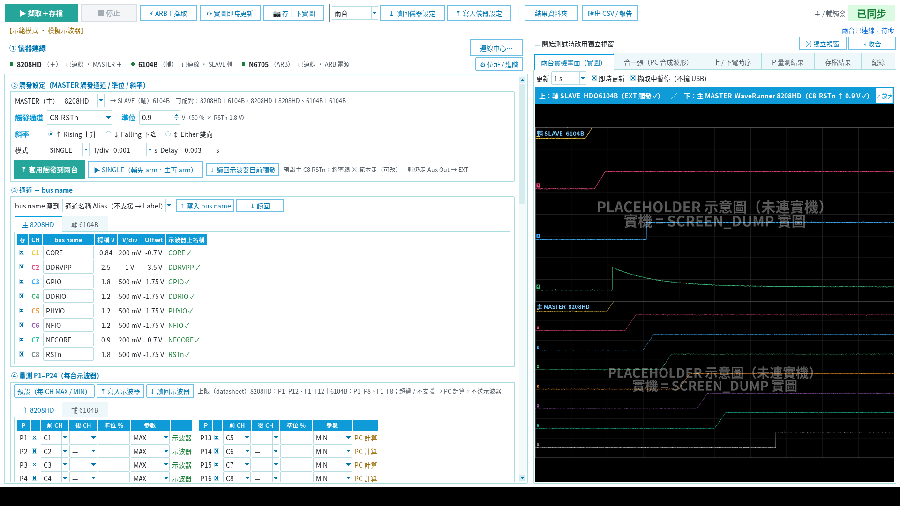
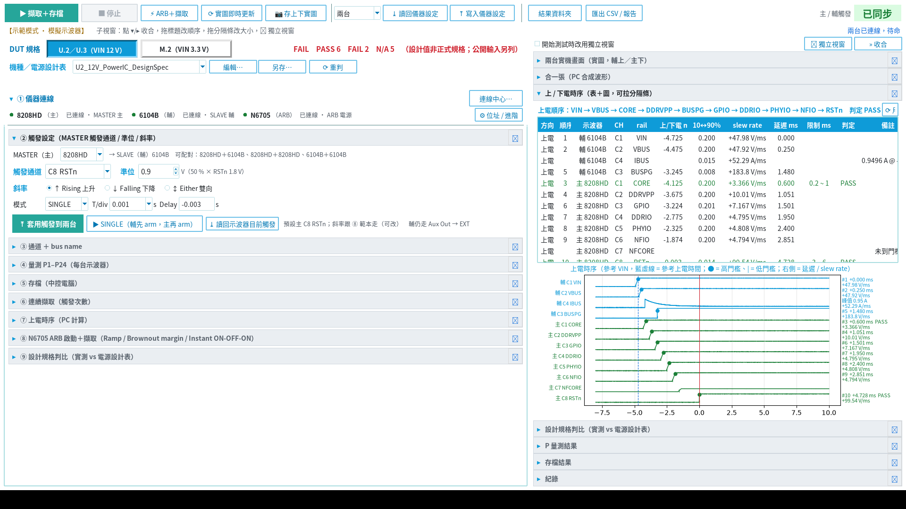
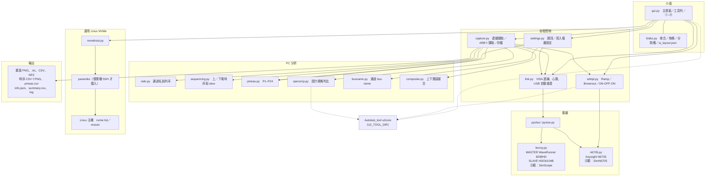

# 8208-6104 Remote Console（ScopeWaveSaver）

中控電腦上的雙示波器遠端工具：主 **Teledyne LeCroy WaveRunner 8208HD（MASTER，8 CH）** ＋ 輔 **HDO6104B（SLAVE，4 CH）**。
設定觸發與 bus name、P1–P24 量測，連線後在背景自動對時、Auto scale，並把主 **Aux Out → 輔 EXT** 設成主從觸發（不用 10 MHz 同步）。兩台 **SCREEN_DUMP 實圖**上下無縫接合顯示，波形與量測存到中控電腦。

電源方面接 Keysight **N6705**，用一套共用的參數式 ARB 範本（Ramp／Brownout margin／Instant ON-OFF-ON）套到**一個**選中的輸出通道（CH1／CH3 選擇，**預設 CH3 VIN**；CH2／CH4 在進階）。選用 Linux SSH 做 NVMe rescan；U.2／M.2 電源設計表可與實測做判比。

> **目前狀態：預設為示範模式**（模擬示波器 `SimScope` ＋ 模擬 N6705 `SimN6705`）。連續擷取、上／下電時序、USB 重連、ARB＋擷取都已在示範模式跑過；畫面上的示波器圖是 **PLACEHOLDER 示意圖**。加 `--real` 才走 USB VISA 接實機，**尚未實機測試**。





## 架構圖



資料流摘要：GUI 透過 `link.py` 以 pyvisa 對兩台示波器與 N6705 下指令；擷取流程在 `capture.py`（先輔 arm、再主 arm，必要時先下 ARB 再等觸發）。讀回的波形交給 `sequencing.py`／`pmeas.py`／`speccmp.py` 在 PC 計算，畫面由 `composite.py` 上下接合。Linux NVMe 是選用路徑，未勾選時不連線、也**不 import paramiko**。版型與電源設計表優先使用 Autotest_tool 的 `u2core`（`U2_TOOL_DIR`）。

## 儀器與通道

| 角色 | 機型 | 硬體通道（寫入示波器的對應不變） |
|---|---|---|
| MASTER | WaveRunner 8208HD | C1–C8 = CORE、DDRVPP、GPIO、DDRIO、PHYIO、NFIO、NFCORE、RSTn |
| SLAVE | HDO6104B | C1 VIN、C2 VBUS、C3 BUSPG、C4 IBUS（電流，單位 A） |

列表列序（時序表／圖／時序 CSV、⑨ 規格表、合一張圖例、`summary.csv` 欄位、P 量測列表）是 **輔機訊號在前**：VIN、VBUS、IBUS、BUSPG，再主機 CORE…RSTn。時序「順序」欄仍依上／下電發生時間編號（相對參考 rail，預設 VIN）。示波器端 P 編號不變（8208HD P1–P12、6104B P1–P8；其餘 P 在 PC 計算）。

主觸發預設 **C8 RSTn、準位 0.9 V**（50% × 1.8 V）；斜率 Rising／Falling／Either。換 ARB 範本時斜率會跟著改（Ramp = Rising，Brownout／ON-OFF-ON = Falling），仍可手動改。輔機由主 Aux Out（Trigger Out）經 BNC 接到 EXT（EX10、0.5 V、Rising），連線後背景自動設定。

## 主要功能

**① 儀器連線** — 單列狀態條（色點 ＋ 8208HD／6104B／N6705；啟用 NVMe 時加 Linux 主機）。開程式自動連線；VISA 位址收在 ⚙。對時與 Auto scale 在背景做，只寫紀錄；失敗或斷線才顯示紅字。

**② 觸發** — 來源／準位／斜率／模式、T/div、Delay。主從同步固定寫入，UI 不另顯示，失敗才提示。

**③ 通道 ＋ bus name** — 寫入示波器 Alias／Label（ASCII）。

**④ P1–P24** — 每列標「示波器」或「PC 計算」。超過該台 P／數學通道上限，或型號不支援的參數，不送示波器，改用同一筆波形在 PC 算，寫入前會提醒。

| | WaveRunner 8208HD | HDO6104B |
|---|---|---|
| 示波器量測 P | P1–P12 | P1–P8 |
| 數學通道（V×I 用 Product） | F1–F12 | F1–F8 |
| 參數（兩台 datasheet 都有） | Max、Min、Mean、PkPk、Rise、Fall、Width、Frequency、Delay、Δ Time@level | 同左 |
| 實機確認（Autotest_tool） | Rise、Fall、Max、Min、Mean、PkPk、Delay | 尚無紀錄 |

**⑤ 存檔** — 預設 `桌面\scope waveform\<前綴>_<日期時間>\`。可存上下接合 PNG、兩台原始實圖、.trc／CSV／NPZ、P 量測 CSV、時序 CSV＋PNG、`info.json`。格線區先自動偵測，偵測不到改用 `composite.GRID_FRAC`（實機 MAUI 畫面位置待確認）。

**⑥ 連續擷取** — 觸發次數 N（0 = 直到 ■ 停止）、等觸發逾時。每次一個序號子資料夾，外加跨次數的 `summary.csv`。流程：輔先 arm → 主再 arm → 等主觸發 → 等輔跟隨（逾時仍存主的，並記錄提醒檢查 BNC）。

**⑦ 上／下電時序 ＋ slew rate（PC 計算）** — 用存下來的波形（共同時間軸，t = 0 = 主觸發）。可自動判斷上電或下電。電壓轨報 10↔90% 時間與 slew（V/ms）；RSTn／BUSPG 用邏輯門檻（預設 0.7 × 標稱）；IBUS 報峰值與 A/ms。可選每條 rail 的上／下電延遲上下限 → PASS／FAIL。ARB 每次擷取也走同一套時序（含 slew 與對參考的 Δt）。

**USB 自動重連（`link.py`）** — VISA 錯誤或逾時標成斷線並背景重試（退避 1–30 s）；重連後先重做背景設定。閒置每 3 s 心跳。連續擷取中斷線會暫停，重連後重做該序號。示範可用 `--unplug 6104B:4@3` 或 ⚙ 裡的「模擬拔 USB」。

**⑧ N6705 ARB** — 一套共用範本，一次只套一個通道（預設 CH3 VIN；選 U.2 時標稱 12 V，選 M.2 時 3.3 V）：

| 範本 | 重點參數 | 下載成 |
|---|---|---|
| Ramp | 起始／結束 V、延遲、上升、停留、下降、結束停留、重複 | 原生 Trapezoid |
| Brownout margin | 標稱、掉到（V 或 %，可掃描例如 `-5%/-10%/-20%`）、時間與重複 | 單一準位 = Trapezoid；多段合併 = User Defined |
| Instant ON-OFF-ON | ON 準位、先 ON 停留、OFF 時間（可掃描）、再 ON 停留、重複 | User Defined（ON → 0 V → ON） |

流程：兩台 arm → 下載 ARB → `OUTP ON` → `INIT:TRAN`（只對選中通道）→ `*TRG` → 等主觸發（逾時 = ARB 長度 + 1 s）。沒觸發（例如淺 Brownout 未掉到 UVLO、RSTn 沒跳）→ `summary.csv` 記「未觸發」並換下一個掃描值。■ 停止、錯誤或關視窗會 `ABOR:TRAN` 並可視需要 `OUTP OFF`。N6705 同樣走自動連線與重連；連線後只做 `*CLS` 與對時，**不動輸出**。

示範模式裡，模擬 N6705 的 VIN 會帶動模擬 DUT（VIN ≥ 9.6 V 依序上電、< 9.0 V 依序下電），主觸發看 C8 RSTn。淺 Brownout −10%／−20% 在模擬中通常「未觸發」，−50% 才會觸發；實機 reset IC 行為需另確認。範例：`samples/ARB_Brownout_示範/`、`samples/ARB_ON-OFF-ON_示範/`。

**Linux NVMe rescan（選用，預設關閉）** — 在 ⑧ 勾選後才展開。啟用後 ① 連線列顯示 Linux 主機（綠／灰／紅點，背景探詢與重連），① 下方一行碟機摘要，完整表在可收合的認碟卡。實機 SSH 需要另行安裝 `paramiko`（不在 `requirements.txt`，exe 也未打包）。示範模式用模擬資料。`--nvme` 可在示範裡立刻啟用。

**DUT 規格（最上方固定列）＋ ⑨ 設計規格判比** — U.2／U.3（VIN 12 V）或 M.2（VIN 3.3 V）與電源設計表下拉、總判定，放在 ① 之上、不收合。⑨ 是可收合的實測 vs 設計範圍表。跟隨 Autotest_tool（`u2core.dutspec`／`powerprofile`／`designspec.compare`）；沒有 `U2_TOOL_DIR` 時改用隨附副本 `scope_wave_saver/specs/dut_power/`。設計值標明「非正式規格」。公開輸入另列、不與設計表混寫：U.2 12V ±8%（11.04–12.96 V；設計表 VIN 為 11.4–13.2）、M.2 3.3V ±5%（3.135–3.465 V）。缺 min–max 的軌標 **待填**，不臆造（見下方待辦）。

**版面** — 視窗針對 1920×1080，預設約 **1920×1040**（留工作列）；程式會在 Windows 上試 `state("zoomed")` 最大化（尚未在實機 Windows 確認）。①–⑨ 與右欄各區可收合、拖標題改順序、拉分隔條、⧉ 拆成獨立視窗；狀態存 `%APPDATA%\scope_wave_saver\ui_layout.json`（Linux：`~/.config/scope_wave_saver/ui_layout.json`）。工具列：▶ 擷取＋存檔、■ 停止、⚡ ARB＋擷取、⟳ 實圖即時更新、📷 存上下實圖、⤓ 讀回／⤒ 寫入儀器設定。

更多畫面說明見 `screenshots/`（例如 `ui_arb_RAMP.png`、`ui_folded.png`、`ui_spec_U2.png`、`ui_nvme_line.png`）。

## 執行（Windows）

需要：Python 3.10–3.13（64 位元）、NI-VISA 或 Keysight IO Libraries，以及 Autotest_tool 的 `u2core`（版型與元件共用，不放在本 repo）。套件見 `requirements.txt`：numpy、matplotlib、pillow、pyvisa、pyvisa-py。示範模式在 Linux 也可以跑（不需 VISA）；實機 USB 與打包以 Windows 為主。

**最簡單：雙擊 `run.bat`**（第一次會建 `.venv` 並裝套件；`U2_TOOL_DIR` 預設 `D:\0.Project\Github_project\Autotest_tool`，可先 `set` 覆寫）。

```bat
git clone https://github.com/Jacky56-wei/8208-6104-Remote-Console.git
cd 8208-6104-Remote-Console
py -3 -m pip install -r requirements.txt
set U2_TOOL_DIR=D:\0.Project\Github_project\Autotest_tool
py -3 -m scope_wave_saver.gui
REM 接實機：py -3 -m scope_wave_saver.gui --real
REM 或：run.bat --real
```

實機 Linux NVMe 另需：`py -3 -m pip install paramiko`。

### 指令列參數

| 參數 | 說明 |
|---|---|
| `--real` | 接實機（USB VISA）。**預設是示範模式**（沒有 `--demo` 旗標） |
| `--view stack\|merge\|seq` | 開在上下實圖／合一張／上／下電時序（預設 `stack`） |
| `--capture N` | 啟動後自動擷取 N 次（0 = 直到停止） |
| `--arb N` | 啟動後自動 ⚡ ARB＋擷取，循環 N 次 |
| `--arb-tpl RAMP\|BROWNOUT\|ONOFFON` | 示範／測試用共用範本 |
| `--arb-ch 1\|2\|3\|4` | ARB 輸出通道（預設 3） |
| `--form U2\|M2` | DUT 規格 |
| `--profile <名稱>` | 電源設計表名稱 |
| `--nvme` | 啟用 Linux NVMe rescan（示範為模擬資料） |
| `--unplug 6104B:4@3` | 示範：模擬拔 USB |
| `--folder <資料夾>` | 存檔位置 |
| `--save-to <資料夾>` | 測試：把目前畫面存到此資料夾 |
| `--layout <檔或 - >` | 版面 json；`-` = 不讀不寫 |

重產示意圖：`py -3 -m scope_wave_saver.demo_screens`。

## 測試

```bat
py -3 -m unittest discover -s tests
```

目前 12 項，涵蓋規格判比、版面遷移、NVMe 示範連線列，以及輔機訊號列序（VIN、VBUS、IBUS、BUSPG 在前）。

## 打包成 exe（Windows）

**雙擊 `build.bat`** → `dist\ScopeWaveSaver\ScopeWaveSaver.exe`（目標電腦不需 Python，但仍需 NI-VISA／Keysight IO）。

```bat
set U2_TOOL_DIR=D:\0.Project\Github_project\Autotest_tool
py -3 -m pip install -r requirements.txt pyinstaller
py -3 -m PyInstaller --noconfirm --clean ScopeWaveSaver.spec
```

`ScopeWaveSaver.spec` 入口為 `run_gui.py`；打包時從 `U2_TOOL_DIR` 收進用到的 `u2core` 與 `scope_wave_saver\assets`。PySide6、scipy、**paramiko** 等排除在外（exe 內的 NVMe 實機 SSH 不可用，除非另行調整 spec）。`dist\`、`build\`、`.venv\` 不進 git。

## 目錄清單

```
.
├── README.md                          本說明（架構、目錄、待辦與操作）
├── README_zh-TW.md                    指向 README.md
├── .gitignore                         忽略 dist／build／.venv／__pycache__ 等
├── requirements.txt                   執行依賴（不含選用的 paramiko）
├── run.bat                            Windows 啟動（可附加 --real 等參數）
├── build.bat                          Windows 以 ScopeWaveSaver.spec 打包 exe
├── run_gui.py                         PyInstaller／直接執行的入口
├── ScopeWaveSaver.spec                PyInstaller 設定（一併打包 u2core）
├── scope_wave_saver/                  主套件
│   ├── __init__.py                    套件版本
│   ├── __main__.py                    python -m scope_wave_saver → gui
│   ├── gui.py                         主視窗、工具列、①–⑨、指令列
│   ├── foldui.py                      子視窗收合／拖移／分隔條／ui_layout.json
│   ├── capture.py                     連續擷取與 ARB＋擷取流程、存檔、summary.csv
│   ├── lecroy.py                      LeCroy VISA 與示範 SimScope
│   ├── link.py                        每台儀器一把鎖、心跳、USB 自動重連
│   ├── n6705.py                       N6705 ARB 下載／啟動／安全中止與 SimN6705
│   ├── arbtpl.py                      三種參數式 ARB 範本與掃描
│   ├── settings.py                    讀回／寫入觸發、時基、通道、P、主從同步
│   ├── busname.py                     通道 Alias／Label
│   ├── rails.py                       通道名、標稱、SIGNAL_ORDER 列序
│   ├── sequencing.py                  上／下電時序、slew、Δt、PASS／FAIL
│   ├── pmeas.py                       P1–P24 示波器與 PC 計算
│   ├── speccmp.py                     U.2／M.2 設計規格判比
│   ├── composite.py                   兩台 SCREEN_DUMP 上下無縫接合
│   ├── nvmehost.py                    選用 Linux SSH NVMe rescan
│   ├── demo_screens.py                示範用示波器示意圖
│   ├── demo_scale.py                  示範畫面縮放輔助
│   ├── assets/                        示範 PLACEHOLDER 實圖
│   │   ├── placeholder_8208HD.png
│   │   └── placeholder_6104B.png
│   └── specs/                         隨附設計表（與 Autotest origin/main 同檔）
│       ├── README.md                  來源與「待填」原則
│       ├── public_input.json          公開輸入預設（與設計表分開）
│       ├── timing_ref.json            soft-start／RSTn typ（只記錄）
│       └── dut_power/
│           ├── U2_12V_PowerIC_DesignSpec.json
│           └── M2_3V3_PowerIC_DesignSpec.json
├── tests/
│   ├── test_speccmp.py                規格判比、版面遷移、NVMe 示範列
│   └── test_slave_first.py            輔機訊號列序
├── samples/                           示範模式範例輸出
│   ├── 畫面_上下.png、主_8208HD_實圖.png、輔_6104B_實圖.png
│   ├── 連續擷取_示範/                  上電＋下電各一次及 summary.csv
│   ├── ARB_Brownout_示範/             含未觸發的淺 brownout 列
│   └── ARB_ON-OFF-ON_示範/
└── screenshots/                       示範模式 UI 截圖（17 張）
```

擷取過程紀錄另外寫到 `桌面\scope waveform\scope_wave_saver.log`。

## 待辦事項

- [ ] **`--real` 實機驗證**（儀器尚未接上）。示範模式已跑過連線 → 背景設定 → arm → ARB → 觸發 → 讀／存 → 時序 → 斷線重連；實機 USB VISA 流程尚未測過。
- [ ] **Windows 最大化**：程式在 1920×1080 會設約 1920×1040 並呼叫 `state("zoomed")`，尚未在實機 Windows 確認。
- [ ] **實機 SSH／Linux NVMe rescan**：連線列狀態、一行碟機資訊、認碟表、擷取後更新；目前只有示範模擬資料。
- [ ] **讀回／寫入儀器設定**（`settings.py` 註明為草稿，尚未實機測試）。
- [ ] **實機 SCREEN_DUMP 格線區**：`composite.GRID_FRAC` 尚未對實機 MAUI 畫面確認（自動偵測優先）。
- [ ] **6104B P 量測實機讀回比對**：8208HD 在 Autotest_tool 已確認 Rise／Fall／Max／Min／Mean／PkPk／Delay；6104B 尚無紀錄；其餘參數依手冊，寫入後需讀回比對。
- [ ] **規格欄位待填**（有值才判比，不臆造）：
  - U.2 設計表無 min–max：PHYIO、VBUS、BUSPG、RSTn
  - M.2 設計表無 min–max：VBUS、BUSPG、RSTn（PHYIO 在 M.2 表已有範圍）
  - U.2／M.2：**IBUS max**（設計表與 `timing_ref.json` 皆為空；Autotest 僅有 MP5519 預充 150 mA 註記）
  - U.2 公開輸入：**3.3Vaux** 上下限
  - **slew／Δt 正式上下限**（⑦ 由使用者自填；設計參考只記錄 soft-start／RSTn typ，不計入總判定）
- [ ] **淺 Brownout（−10%／−20%）**：模擬中 VIN 需低於約 9.0 V（UVLO）RSTn 才會掉，故這兩檔常記「未觸發」。實機 reset IC 是否在較淺掉電就動作，需接儀器後確認。

## 參考（Autotest_tool／All in Test tool）

| 功能 | 參考模組 |
|---|---|
| 實圖 | `u2core/scope8208.py`：`HARDCOPY_SETUP` → `SCREEN_DUMP` |
| 波形 | `u2tools/timing/scope_hdo.py`：`Cn:WAVEFORM? ALL`、WAVEDESC |
| bus name | `u2core/scopesync.py`：Alias／LabelsText |
| P1–P24 | `u2core/pmtable.py` |
| Auto scale | `u2core/scopescale.py` |
| 主從觸發 | `u2core/scope2.py`：`AUXILIARY_OUTPUT TRIGGER_OUT`、SLAVE `TRIG_SELECT EDGE,SR,EX10` |
| 觸發／Either | `u2core/trigpanel.py` |
| 對時 | `u2core/timesync.py`／`scopeext.py` |
| 自動連線 | `u2core/autoconn.py`；位址 `u2core/instruments.py` KNOWN_ADDR |
| ARB／電源設計表 | `u2core.arbmodule`、`u2core.powerprofile`、`u2core.dutspec`、`u2core.designspec` |
