# ScopeWaveSaver 功能介面操作手冊

> 給測試人員的圖文操作說明：兩台 LeCroy 示波器（主 8208HD、輔 6104B）加 Keysight N6705，用來擷取 U.2／M.2 SSD 的上電、下電時序、突波雜訊，並自動判定規格。
>
> 本手冊的畫面都是**示範模式**（模擬示波器）截的圖。實機接上後，介面與流程一樣，只有波形圖是真實的 SCREEN_DUMP。
>
> 文字說明對應程式版本：`main`（含 ARB、規格判比、輔機訊號列前、自動認盤、突波雜訊）。

**目錄**

1. [先看這裡：5 分鐘上手](#1-先看這裡5-分鐘上手)
2. [安裝與啟動](#2-安裝與啟動)
3. [畫面總覽](#3-畫面總覽)
4. [儀器接線](#4-儀器接線)
5. [操作流程（一步一步）](#5-操作流程一步一步)
    - 5.1 [選 DUT 機種（U.2／M.2）](#51-選-dut-機種u2m2)
    - 5.2 [連線與自動設定](#52-連線與自動設定)
    - 5.3 [設定觸發（預設用 RSTn）](#53-設定觸發預設用-rstn)
    - 5.4 [通道名稱與 bus name](#54-通道名稱與-bus-name)
    - 5.5 [存檔位置與連續擷取](#55-存檔位置與連續擷取)
    - 5.6 [一般上電／下電時序擷取](#56-一般上電下電時序擷取)
    - 5.7 [N6705 ARB 三個模板](#57-n6705-arb-三個模板)
    - 5.8 [P 量測](#58-p-量測)
    - 5.9 [突波／雜訊量測](#59-突波雜訊量測)
    - 5.10 [規格判比](#510-規格判比)
    - 5.11 [Linux NVMe 認盤（手動＋自動）](#511-linux-nvme-認盤手動自動)
    - 5.12 [連續擷取與 USB 斷線](#512-連續擷取與-usb-斷線)
    - 5.13 [面板收合、拖移與版面](#513-面板收合拖移與版面)
6. [輸出檔案說明](#6-輸出檔案說明)
7. [常見問題與排除](#7-常見問題與排除)
8. [附錄：按鈕速查與示範旗標](#8-附錄按鈕速查與示範旗標)

---

## 1. 先看這裡：5 分鐘上手

整個工具的工作只有一件事：**同時抓兩台示波器的波形，在電腦上算出時序、突波雜訊並判定，最後把結果存成資料夾**。

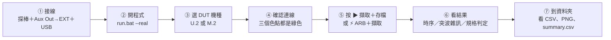

最短操作（一般上電擷取）：

1. 接好線（第 4 章），雙擊 `run.bat --real`（第 2 章）。
2. 上方「DUT 規格」選 **U.2／U.3** 或 **M.2**。
3. 看 ① 的三個點都是綠色（8208HD、6104B、N6705）。
4. 按左上角綠色的 **▶ 擷取＋存檔**，再給 DUT 上電。
5. 右欄「上／下電時序」會出現表格和圖，上方的 PASS／FAIL 就是判定。

> **提醒：** 程式預設是**示範模式**。沒加 `--real` 時，左上角會顯示橘色「【示範模式 · 模擬示波器】」，波形是假的。實機測試一定要確認這行字**不見了**。

---

## 2. 安裝與啟動

### 2.1 需要什麼

| 項目 | 說明 |
|---|---|
| 作業系統 | Windows（中控電腦） |
| Python | 3.10–3.13（64 位元）。只用 exe 的話不用裝 |
| VISA | NI-VISA 或 Keysight IO Libraries（連 USB-TMC 儀器用） |
| Autotest_tool | 需要它的 `u2core`（共用版型與元件），不放在本 repo 裡 |
| 儀器 | WaveRunner 8208HD、HDO6104B、N6705，各一條 USB 到中控電腦 |
| 選用 | Linux 主機（SSH，用來認 NVMe 碟）；實機 SSH 另外要 `pip install paramiko` |

### 2.2 用 run.bat 啟動（最簡單）

1. 取得程式：`git clone https://github.com/Jacky56-wei/8208-6104-Remote-Console.git`。
2. 雙擊 **`run.bat`**。第一次會自動建立 `.venv` 並安裝套件，要等一下。
3. `run.bat` 需要知道 Autotest_tool 在哪裡，由環境變數 **`U2_TOOL_DIR`** 決定，預設是 `D:\0.Project\Github_project\Autotest_tool`。放在別的地方請先設定：

```bat
set U2_TOOL_DIR=D:\你的路徑\Autotest_tool
run.bat
```

找不到 `u2core` 時，`run.bat` 會顯示 `[錯誤] 找不到 …\u2core`，照上面設定就好。

### 2.3 示範模式與實機模式

| 啟動方式 | 模式 | 用途 |
|---|---|---|
| `run.bat` | **示範模式**（預設）：模擬示波器、模擬 N6705 | 練習操作、教學、截圖 |
| `run.bat --real` | **實機模式**：透過 USB VISA 連真的儀器 | 正式量測 |

示範模式會自己跑完整流程，包含擷取、ARB、突波雜訊、規格判比與 NVMe 認盤（模擬資料），很適合先熟悉介面。

### 2.4 打包成 exe（選用）

雙擊 **`build.bat`**，完成後在 `dist\ScopeWaveSaver\ScopeWaveSaver.exe`。目標電腦不需要 Python，但仍要裝 NI-VISA 或 Keysight IO。exe 內**沒有**打包 paramiko，所以 exe 版不能做實機 SSH 認盤（要認盤請用 `run.bat`）。

---

## 3. 畫面總覽

視窗針對 **1920×1080** 設計（預設約 1920×1040，留出工作列）。左邊是設定區，右邊是結果區。

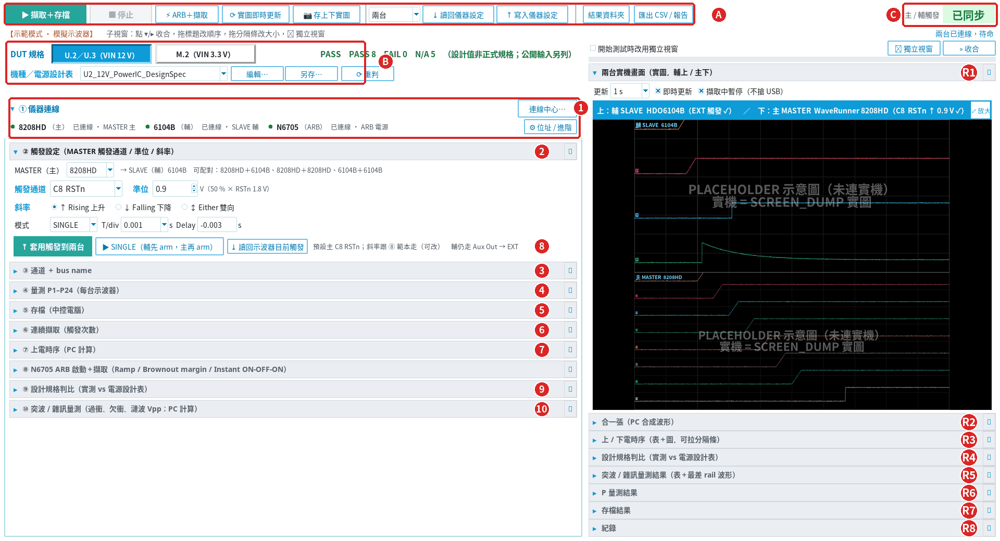

*圖 1　主畫面與編號說明（紅色編號對應下表）*

| 編號 | 位置 | 作用 | 本手冊章節 |
|---|---|---|---|
| **A** | 最上面的工具列 | 開始／停止擷取、ARB、讀回／寫入示波器設定 | 3.1 |
| **B** | DUT 規格（固定在最上方） | 選 U.2／U.3 或 M.2，選電源設計表，顯示總判定 | 5.1 |
| **C** | 右上角「已同步」 | 主／輔觸發狀態燈 | 5.12 |
| **1** | ① 儀器連線 | 三台儀器（加選用的 Linux）的連線色點 | 5.2 |
| **2** | ② 觸發設定 | 觸發通道、準位、斜率、模式 | 5.3 |
| **3** | ③ 通道＋bus name | 通道名稱寫進示波器 | 5.4 |
| **4** | ④ 量測 P1–P24 | 示波器量測或電腦計算 | 5.8 |
| **5** | ⑤ 存檔 | 存到哪、存哪些檔案 | 5.5 |
| **6** | ⑥ 連續擷取 | 觸發次數、等觸發逾時 | 5.5、5.12 |
| **7** | ⑦ 上電時序 | 時序、slew rate 的設定與判定限值 | 5.6 |
| **8** | ⑧ N6705 ARB | 三個 ARB 模板、選用 Linux NVMe 認盤 | 5.7、5.11 |
| **9** | ⑨ 設計規格判比 | 實測值和電源設計表比對 | 5.10 |
| **10** | ⑩ 突波／雜訊量測 | 過衝、欠衝、漣波的設定與限值 | 5.9 |
| **R1–R8** | 右欄八個結果面板 | 實圖、合一張、時序、判比、突波、P、存檔、紀錄 | 5.6 起 |

> 左邊每一張卡片（① 到 ⑩）和右邊每個面板都可以**收合、拖移、拉大小**，見 5.13。

### 3.1 工具列


*圖 2　工具列按鈕*

| 編號 | 按鈕 | 作用 |
|---|---|---|
| 1 | **▶ 擷取＋存檔** | 依 ⑥ 的次數開始擷取，每次觸發存一組檔案 |
| 2 | **■ 停止** | 停止擷取（ARB 時會一併安全中止 N6705） |
| 3 | **⚡ ARB＋擷取** | 先下 ARB 波形給 N6705，再擷取（見 5.7） |
| 4 | ⟳ 實圖即時更新 | 保留按鈕，目前沒有動作；要看即時畫面請用右欄 R1 的「更新」與「即時更新」 |
| 5 | **📷 存上下實圖** | 把目前顯示的兩台實圖存成上下接合的一張 PNG |
| 6 | 兩台／主／輔 下拉 | 決定 7、8 要對哪一台動作 |
| 7 | ⤓ 讀回儀器設定 | 從示波器把目前設定讀進畫面 |
| 8 | ⤒ 寫入儀器設定 | 把畫面上的設定寫進示波器 |
| 9 | 結果資料夾 | 保留按鈕，目前沒有動作；請用檔案總管開存檔資料夾 |
| 10 | 匯出 CSV／報告 | 保留按鈕，目前沒有動作；每次擷取已自動存 CSV |
| 11 | 已同步 | 主／輔觸發同步狀態；擷取中會顯示「擷取中」，斷線時顯示「暫停」 |

---

## 4. 儀器接線

### 4.1 接線圖

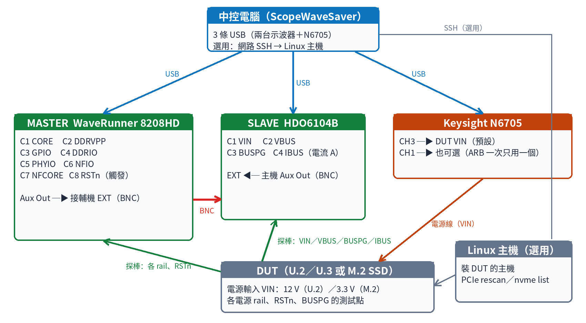

*圖 3　儀器接線示意*

三條 **USB** 接中控電腦；兩台示波器之間只要**一條 BNC**：**主機 8208HD 的 Aux Out → 輔機 6104B 的 EXT**。主機一觸發，輔機就跟著觸發，兩台共用同一個時間軸（t = 0 就是主機觸發的那一刻）。這條線的軟體設定（Aux Out、EXT 準位）程式連線後會自動做，**不用手動設**，也**不需要 10 MHz 同步線**。

### 4.2 通道對照表

| 儀器 | 通道 | 訊號 |
|---|---|---|
| **MASTER 8208HD**（8 通道） | C1 | CORE |
| | C2 | DDRVPP |
| | C3 | GPIO |
| | C4 | DDRIO |
| | C5 | PHYIO |
| | C6 | NFIO |
| | C7 | NFCORE |
| | C8 | **RSTn**（預設觸發來源） |
| **SLAVE 6104B**（4 通道） | C1 | VIN |
| | C2 | VBUS |
| | C3 | BUSPG |
| | C4 | IBUS（電流探棒，單位 A） |

> **看表的順序：** 表格、圖、規格表和 CSV 都固定用「**輔機訊號在前**」：**VIN、VBUS、IBUS、BUSPG**，後面才是主機 **CORE … RSTn**。這只是顯示順序，示波器上的通道對應不變（6104B 的 C3 仍是 BUSPG、C4 仍是 IBUS）。

### 4.3 N6705 接哪裡

- 預設用 **CH3 = DUT 的 VIN（12 V）**；也可選 **CH1**（⑧ 上方有 CH1／CH3 兩個大按鈕）。
- ARB 一次**只用一個通道**，另一個通道不動。CH2、CH4 在 ⑧ 的「進階」裡。
- U.2 的 VIN 標稱 12 V；M.2 的 VIN 標稱 3.3 V，選 DUT 機種時會自動帶入。

### 4.4 接好線的確認清單

- [ ] 三條 USB 都接好，儀器電源已開。
- [ ] 主 Aux Out → 輔 EXT 的 BNC 已接。
- [ ] 6104B 的 C1–C4 探棒分別接 VIN、VBUS、BUSPG、IBUS。
- [ ] 8208HD 的 C1–C8 探棒依第 4.2 表接好，**C8 接 RSTn**。
- [ ] N6705 的 CH3（或 CH1）接到 DUT 電源輸入。
- [ ] 用 `--real` 啟動，① 三個點為綠色。

---

## 5. 操作流程（一步一步）

先看整體順序：

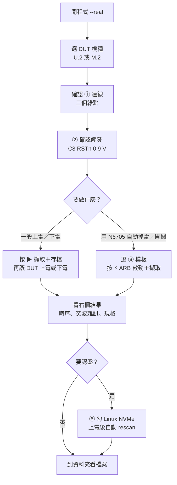

### 5.1 選 DUT 機種（U.2／M.2）

「DUT 規格」固定在畫面最上方，不會被收合。

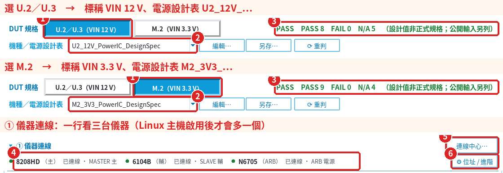

*圖 4　DUT 規格與連線列*

1. 按 **U.2／U.3（VIN 12 V）** 或 **M.2（VIN 3.3 V）**（編號 1）。選中的按鈕會變藍色。
2. 「機種／電源設計表」（編號 2）會自動換成對應的設計表：U.2 是 `U2_12V_PowerIC_DesignSpec`，M.2 是 `M2_3V3_PowerIC_DesignSpec`。要換別的機種可以從下拉選。
3. 右邊的 **PASS／FAIL／N/A 計數**（編號 3）是目前整體規格判定，下面 5.10 會說明。
4. 選完後，⑧ ARB 的標稱電壓、⑨ 規格表的標稱和範圍都會跟著換。

> 設計表上的數值是「設計值，**非正式規格**」，畫面上也會這樣註明。欄位標「**待填**」代表設計表沒有填這個上下限，不是程式壞掉。

### 5.2 連線與自動設定

程式一開就**自動連線**，不需要按連線鈕。

- ① 那一行有三個點：**8208HD（主）、6104B（輔）、N6705（ARB 電源）**。綠色點＝已連線；灰色或紅色＝還沒連上或斷線。
- 連上後程式會在**背景**自動做：對時、Auto scale、把主 Aux Out → 輔 EXT 設好。全部靜靜地做，**不會跳視窗**，失敗或斷線才會出現紅字。
- 「⚙ 位址／進階」可以看或改 VISA 位址；「連線中心…」開啟儀器連線中心（Autotest_tool 共用元件）。
- 啟用 Linux NVMe（5.11）後，這行會多一個 **Linux 主機** 的點。

> 斷線不用緊張：程式會自動重連（間隔 1 → 30 秒），連續擷取中途斷線會**暫停**，重連後重做那一次（見 5.12）。

### 5.3 設定觸發（預設用 RSTn）

打開 **② 觸發設定**。

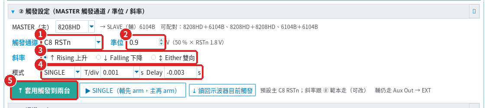

*圖 5　② 觸發設定*

| 編號 | 欄位 | 怎麼設 |
|---|---|---|
| 1 | 觸發通道 | 預設 **C8 RSTn**（主機 C8）。這是整個時序的 t = 0 |
| 2 | 準位 | 預設 **0.9 V**（RSTn 1.8 V 的 50 %） |
| 3 | 斜率 | **Rising 上升**（上電）、**Falling 下降**（下電）、**Either 雙向** |
| 4 | 模式／T/div／Delay | 預設 SINGLE（單次）、1 ms/div、Delay −3 ms。Delay 負值 = 看觸發前的波形 |
| 5 | **套用觸發到兩台** | 把設定寫進示波器 |

- 用 ⑧ ARB 時，斜率會**自動跟著範本改**：Ramp＝Rising，Brownout 與 ON-OFF-ON＝Falling。你仍然可以手動改。
- 輔機不用另外設，它由主 Aux Out 觸發。

### 5.4 通道名稱與 bus name

打開 **③ 通道＋bus name**，可以把訊號名稱（VIN、VBUS…）寫進示波器，這樣示波器畫面上也看得到名字。

1. 上方 tab 切換 **輔 6104B**／**主 8208HD**。
2. 表格欄位：存（是否啟用）、CH、bus name、標稱 V、V/div、Offset、「示波器上名稱」（綠色 ✓ 代表已寫入）。
3. 按 **⤒ 寫入 bus name** 寫進示波器；按 **⤓ 讀回** 把示波器現有名稱讀回來。

（畫面見下一節圖 6 上半部）

### 5.5 存檔位置與連續擷取

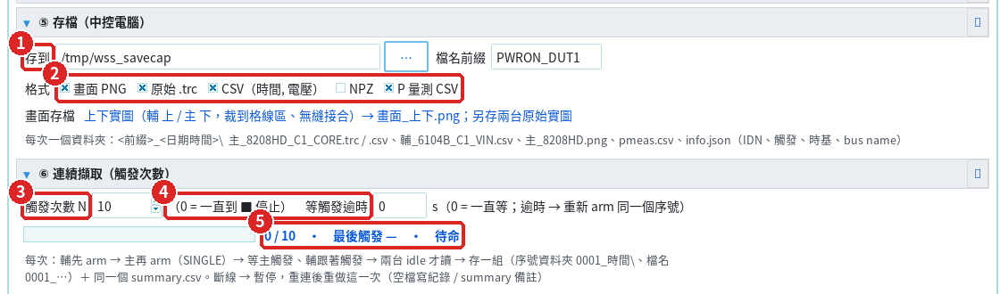

*圖 6　⑤ 存檔與 ⑥ 連續擷取*

**⑤ 存檔**

| 編號 | 項目 | 說明 |
|---|---|---|
| 1 | 存到 | 預設 `桌面\scope waveform`。按 **…** 可以換位置 |
| 2 | 格式 | 畫面 PNG、原始 .trc、CSV（時間, 電壓）、NPZ、P 量測 CSV。**勾了才會存** |

**⑥ 連續擷取**

| 編號 | 項目 | 說明 |
|---|---|---|
| 3 | 觸發次數 N | 要擷取幾次。**0＝一直做到按 ■ 停止** |
| 4 | 等觸發逾時 | 等多久還沒觸發就放棄。**0＝一直等** |
| 5 | 進度列 | 例如「0 / 10 · 最後觸發 — · 待命」 |

每次觸發存成一個序號資料夾（`0001_時間`、`0002_時間` …），另外一個 `summary.csv` 把每次的重點整理成一張表（第 6 章）。

### 5.6 一般上電／下電時序擷取

這是最常用的流程：不用 N6705，自己手動（或用其他設備）給 DUT 上電、下電。

**操作步驟**

1. 確認 5.1–5.3 都設好。
2. 到 **⑥** 設觸發次數，例如 10 次。
3. 按工具列 **▶ 擷取＋存檔**。程式先讓輔機 arm，再讓主機 arm，然後等觸發。
4. 對 DUT 上電（或下電）。主機 C8 RSTn 一過準位，兩台同時擷取。
5. 程式自動讀波形、存檔、計算時序，右欄跟著更新。

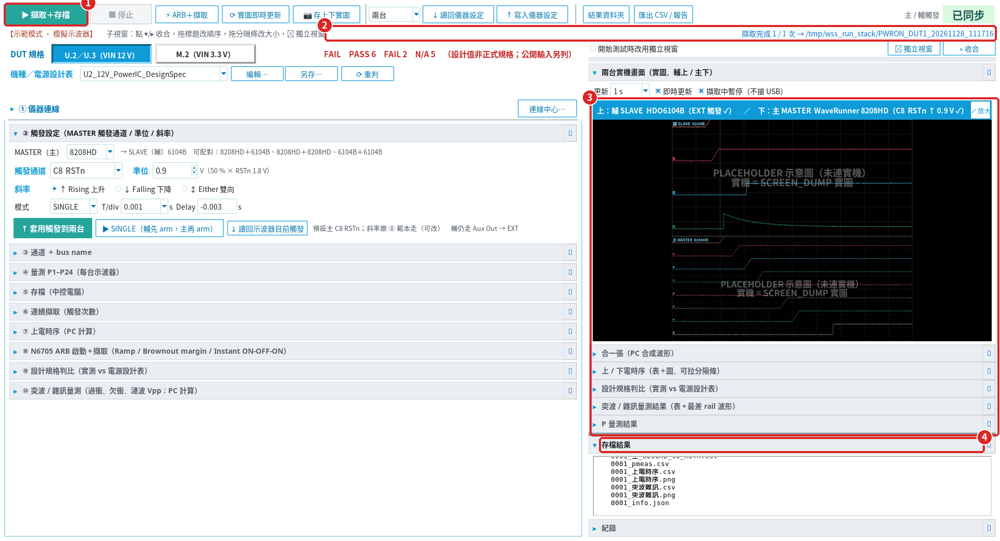

*圖 7　擷取後的畫面*

| 編號 | 看哪裡 | 說明 |
|---|---|---|
| 1 | ▶ 擷取＋存檔 | 擷取中會變成不可按，**■ 停止**變紅色 |
| 2 | 右上角訊息 | 例如「擷取完成 1 / 1 次 → 存檔路徑」 |
| 3 | R1 兩台實機畫面 | 上面是輔機、下面是主機，無縫接在一起（示範模式是佔位示意圖） |
| 4 | R7 存檔結果 | 這次存了哪些檔案 |

**看時序結果**：展開右欄 **R3「上／下電時序」**。

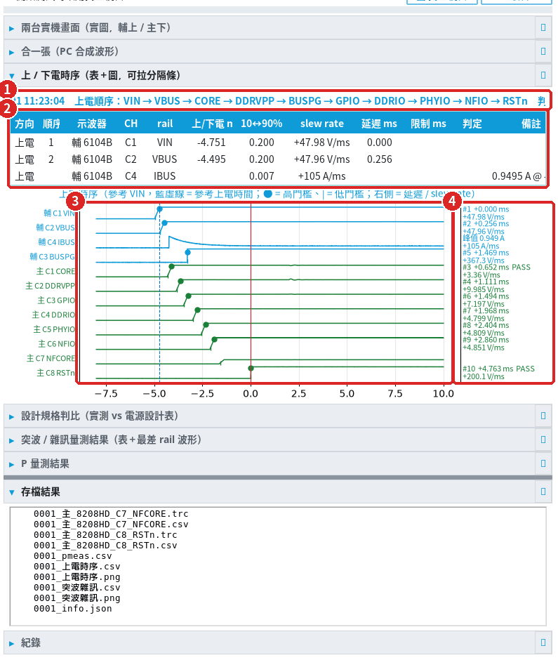

*圖 8　上電時序（表格與圖）*

| 編號 | 位置 | 怎麼看 |
|---|---|---|
| 1 | 順序文字 | 「上電順序：VIN → VBUS → CORE → …」，依實際發生的時間排好 |
| 2 | 時序表 | 每一列一條訊號：方向、順序號、示波器、通道、rail、上／下電時間、10↔90 % 時間、**slew rate**、延遲（對參考 rail）、限制、判定、備註 |
| 3 | 時序圖 | 每條 rail 一條線；圓點＝達到高門檻，虛線＝參考 rail 上電時間，紅線＝t = 0 |
| 4 | 圖右側文字 | 每條 rail 的延遲（ms）與 slew rate（V/ms；電流是 A/ms） |

- **參考 rail** 預設是 VIN，延遲就是相對 VIN 的時間差。
- RSTn 與 BUSPG 是邏輯訊號，用「邏輯門檻」（預設標稱的 0.7 倍）；IBUS 是電流，只記峰值與 A/ms。
- 程式會**自動判斷是上電還是下電**（看波形頭尾）。下電的例子：

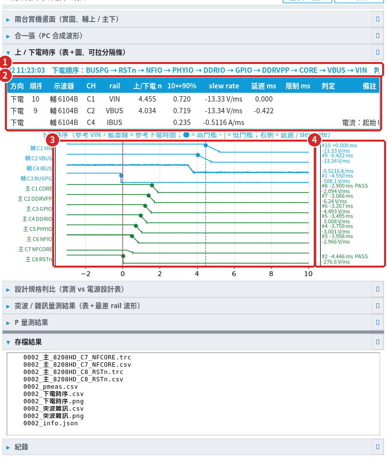

*圖 9　下電時序*

- 想要 PASS／FAIL，就到 **⑦ 上電時序** 幫每條 rail 填「上電延遲」「下電延遲」的下限與上限（ms）。**有填才會判**，沒填的欄位只顯示數字。

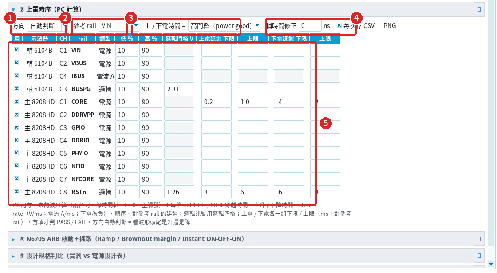

*圖 10　⑦ 時序設定與判定限值*

| 編號 | 項目 | 說明 |
|---|---|---|
| 1 | 方向 | 自動判斷／上電／下電 |
| 2 | 參考 rail | 延遲以誰為 0（預設 VIN） |
| 3 | 上／下電時間＝ | 以「高門檻（power good）」或「低門檻（開始動）」的穿越時間為準 |
| 4 | 每次存 CSV＋PNG | 勾了每次擷取都存時序表與圖 |
| 5 | rail 表 | 低 %、高 %、邏輯門檻 V、上電延遲下限／上限、下電延遲下限／上限 |

**合一張**：右欄 R2「合一張（PC 合成波形）」用讀回的波形資料，把全部通道畫在同一個時間軸上，方便找異常（存檔仍存上下實圖）。

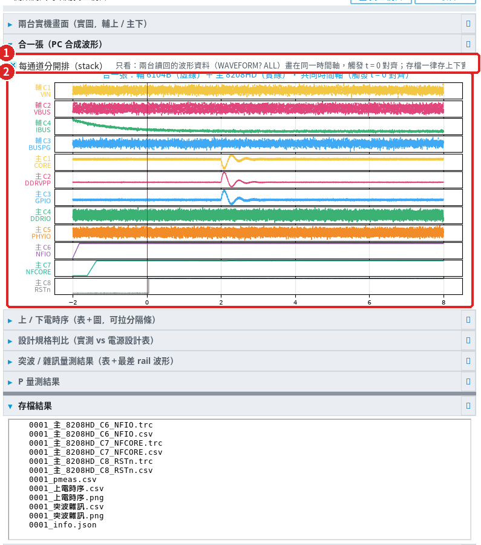

*圖 11　合一張波形*

### 5.7 N6705 ARB 三個模板

ARB 讓 N6705 自動做掉電或開關，同時觸發擷取，不用人工操作電源。打開 **⑧ N6705 ARB 啟動＋擷取**。

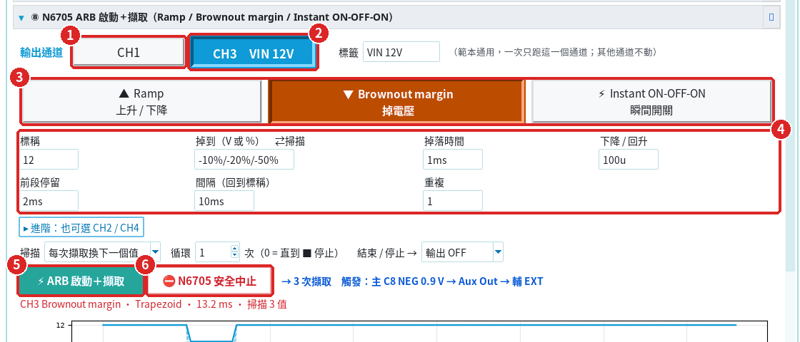

*圖 12　⑧ ARB 介面*

| 編號 | 項目 | 說明 |
|---|---|---|
| 1 | CH1 | 輸出通道選 CH1 |
| 2 | **CH3　VIN 12V**（預設） | 輸出通道選 CH3＝DUT 的 VIN。選 M.2 時標稱會變 3.3 V |
| 3 | **三個大按鈕：模板** | Ramp、Brownout margin、Instant ON-OFF-ON。**選中的按鈕會變色**，下面的參數跟著換 |
| 4 | 參數區 | 依模板顯示不同欄位（見下表） |
| 5 | **⚡ ARB 啟動＋擷取** | 開始。每次擷取後換下一個掃描值 |
| 6 | **⛔ N6705 安全中止** | 隨時可按，立刻中止 ARB |

> **重點：** 三個模板共用，一次**只套用到一個通道**（CH1 或 CH3）。通常只會用一個通道。

| 模板 | 適合做什麼 | 主要參數 | 觸發斜率 |
|---|---|---|---|
| **Ramp**（上升／下降） | 量上電、下電的斜率 | 起始、結束 V；延遲、上升時間、停留、下降時間、結束停留；重複 | Rising |
| **Brownout margin**（掉電壓） | 找 DUT 掉到多低會 reset | 標稱；**掉到（V 或 %，可掃描，例如 −10%/−20%/−50%）**；掉落時間；下降／回升；前段停留；間隔；重複 | Falling |
| **Instant ON-OFF-ON**（瞬間開關） | 模擬瞬間斷電再恢復 | ON 準位；先 ON 停留；**OFF 時間（可掃描，例如 1ms/2ms/5ms）**；再 ON 停留；重複 | Falling |

**三個模板的畫面（每個畫面下方都有波形預覽，可以先確認形狀）**

Ramp：

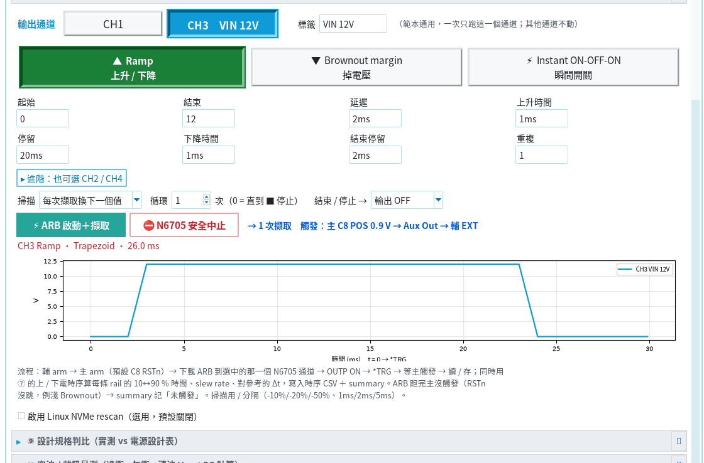

*圖 13　Ramp 模板*

Brownout margin（掃描 −10%／−20%／−50%）：

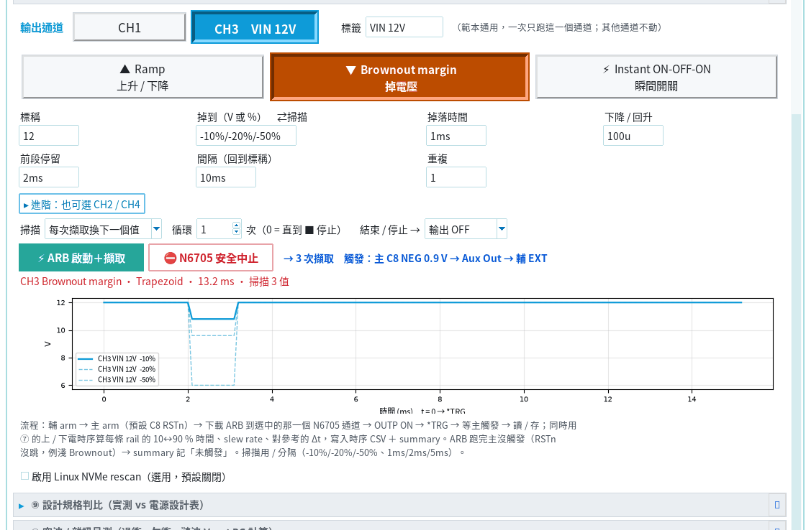

*圖 14　Brownout margin 模板*

Instant ON-OFF-ON（OFF 時間掃描 1/2/5 ms）：

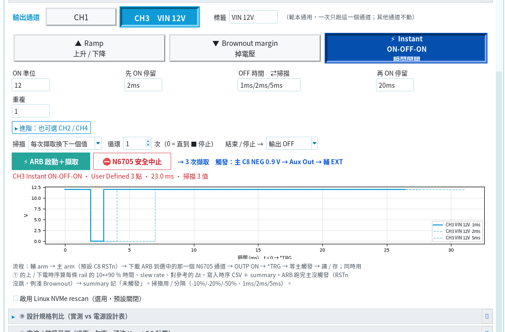

*圖 15　Instant ON-OFF-ON 模板*

**操作步驟**

1. 選輸出通道（CH1 或 CH3）。
2. 按一個模板大按鈕，改參數。
3. 設「掃描」與「循環」次數。有掃描值（例如三個掉電深度）時，**每次擷取換下一個值**。
4. 設「結束／停止 →」：**輸出 OFF**（結束後關閉 N6705 輸出）或維持最後電壓。
5. 按 **⚡ ARB 啟動＋擷取**。
6. 程式依序做：兩台示波器 arm → 下載 ARB → 開輸出 → 啟動 ARB → 觸發 → 等主機觸發 → 讀波形、存檔。

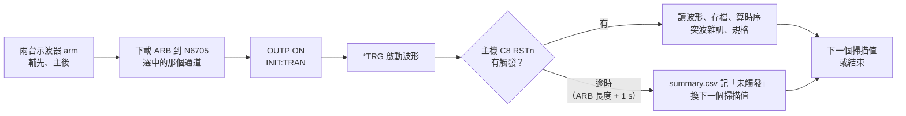

ARB 擷取完看這張時序（Brownout 的例子，最後一個 −50 % 才造成 RSTn 掉下去）：

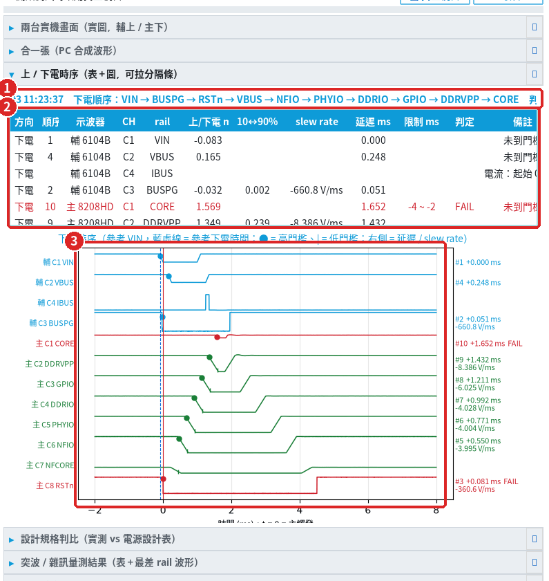

*圖 16　ARB 擷取後的時序*

> **「未觸發」是正常的結果，不是錯誤。** 例如 Brownout 只掉 10 %、DUT 沒有 reset，RSTn 就不會動，程式會在 `summary.csv` 記「未觸發」，然後做下一個掃描值。這正好告訴你「掉到哪個深度才會 reset」。
> 示範模式裡，−10 %、−20 % 通常是未觸發，−50 % 才觸發；實機的 reset IC 行為要以實測為準。

> **安全：** 按 **■ 停止**、發生錯誤或關閉視窗時，程式都會對 N6705 下 `ABOR:TRAN`（中止波形），並依你的設定決定輸出是否關閉。

### 5.8 P 量測

**④ 量測 P1–P24** 設定每台示波器要量什麼；結果在右欄 **R6「P 量測結果」**。

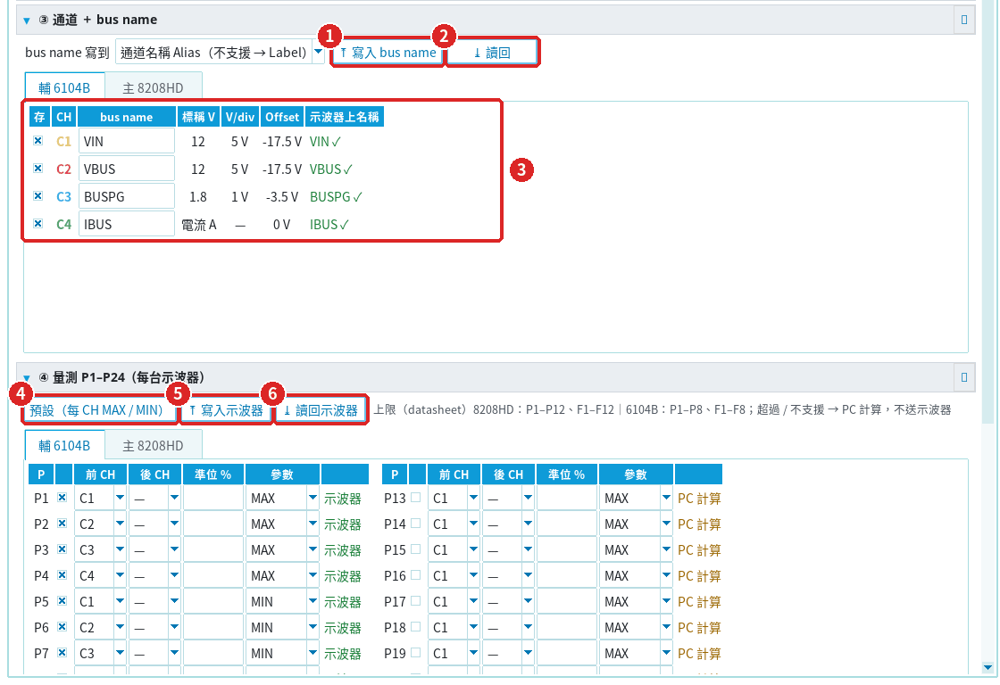

*圖 17　③ 通道名稱與 ④ P 量測設定*

| 編號 | 項目 | 說明 |
|---|---|---|
| 1 | ⤒ 寫入 bus name | 把 bus name 寫進示波器（5.4） |
| 2 | ⤓ 讀回 | 從示波器讀回名稱 |
| 3 | bus name 表 | 每個通道的名稱、標稱、V/div、Offset |
| 4 | **預設（每 CH MAX／MIN）** | 一鍵填好常用量測：每個通道的最大值與最小值 |
| 5 | ⤒ 寫入示波器 | 把 P 設定寫進示波器 |
| 6 | ⤓ 讀回示波器 | 讀回示波器目前的 P 設定 |

- 每一列的右邊標示「**示波器**」或「**PC 計算**」。示波器的 P 量測有數量上限：**8208HD 最多 P1–P12、6104B 最多 P1–P8**。超過上限、或示波器不支援的參數，程式不送示波器，**改用同一筆波形在電腦上計算**，寫入前會提醒。
- 可用的參數：Max、Min、Mean、PkPk、Rise、Fall、Width、Frequency、Delay、Δ Time@level。V×I 的功率（W）用 Product 數學通道。

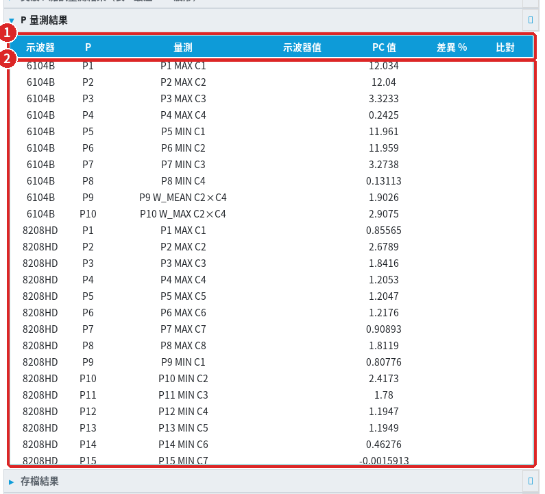

*圖 18　P 量測結果*

| 編號 | 說明 |
|---|---|
| 1 | 欄位：示波器、P、量測、示波器值、PC 值、差異 %、比對 |
| 2 | 每一列一個量測；**PC 值**是電腦用存下來的波形算的。實機時「示波器值」是示波器自己算的，「差異 %」是兩者的差，可用來交叉檢查（示範模式沒有示波器值，所以那兩欄是空的） |

### 5.9 突波／雜訊量測

每條電源 rail 的**過衝、欠衝、漣波（Vpp）與 RMS 雜訊**，由電腦用存下來的波形算，**不佔示波器的 P 欄位**。打開 **⑩ 突波／雜訊量測**。

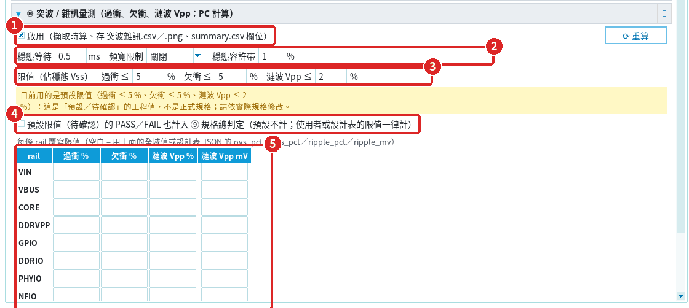

*圖 19　⑩ 突波／雜訊設定*

| 編號 | 項目 | 說明 |
|---|---|---|
| 1 | 啟用 | 勾了擷取時會算，並存 `突波雜訊.csv`、`.png` 與 `summary.csv` 欄位 |
| 2 | 穩態等待、頻寬限制、穩態容許帶 | 穩態等待預設 0.5 ms。**頻寬限制**可選關閉／20／100／200 MHz（數位低通），先濾掉高頻雜訊再算 |
| 3 | 限值 | 過衝、欠衝、漣波 Vpp，都以佔穩態電壓（Vss）的 % 表示。預設 5 %、5 %、2 % |
| 4 | 預設限值也計入 ⑨ 判定 | 預設**不勾**（見下方說明） |
| 5 | 每條 rail 覆寫限值 | 空白＝用上面的全域值；要對某條 rail 另外設，填這裡（漣波也可填 mV） |

> **限值是暫定值：** 設計表目前沒有突波、雜訊的規格，所以程式先用預設 5 %／5 %／2 %。這些**不是正式規格**，預設的 PASS／FAIL 也**不計入 ⑨ 的總判定**。你在表格填了正式限值，就會計入。沒有限值的項目標「**待填**」。

**結果**在右欄 R5「突波／雜訊量測結果」：

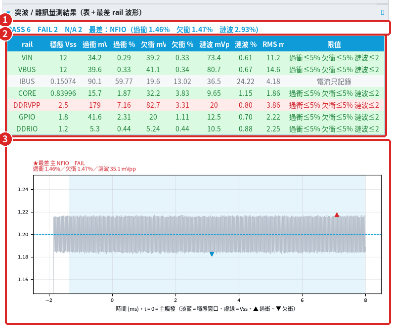

*圖 20　突波／雜訊結果*

| 編號 | 位置 | 怎麼看 |
|---|---|---|
| 1 | 摘要列 | PASS／FAIL／N/A 個數，以及**最差**的 rail（過衝、欠衝、漣波） |
| 2 | 結果表 | 每條 rail：穩態 Vss、過衝（V、%）、欠衝（V、%）、漣波（mVpp、%）、RMS、限值。**紅色列＝FAIL**，灰色＝N/A（例如 IBUS 電流只記錄、不判） |
| 3 | 最差 rail 波形 | 淡藍底＝穩態窗口、虛線＝Vss、▲＝過衝、▼＝欠衝。點表格任一列，波形就換成那條 rail |

- **RSTn、BUSPG 不量**（邏輯訊號）。**IBUS（電流）只記錄**峰值與雜訊，不判 PASS／FAIL。
- 示波器取樣點數有限，高頻漣波（例如 MHz 級開關頻率）的 Vpp 會偏低。要精準量漣波，請縮短時基，或用示波器自己的量測。
- 示範波形刻意帶有雜訊：DDRVPP 過衝約 7 %（FAIL）、NFIO 漣波約 2.9 %（FAIL），讓你看得到判定顏色。

### 5.10 規格判比

⑨ 把**實測值**拿去跟**電源設計表**的上下限比對。選好 DUT 機種後會自動判，結果出現在右欄 R4「設計規格判比」。

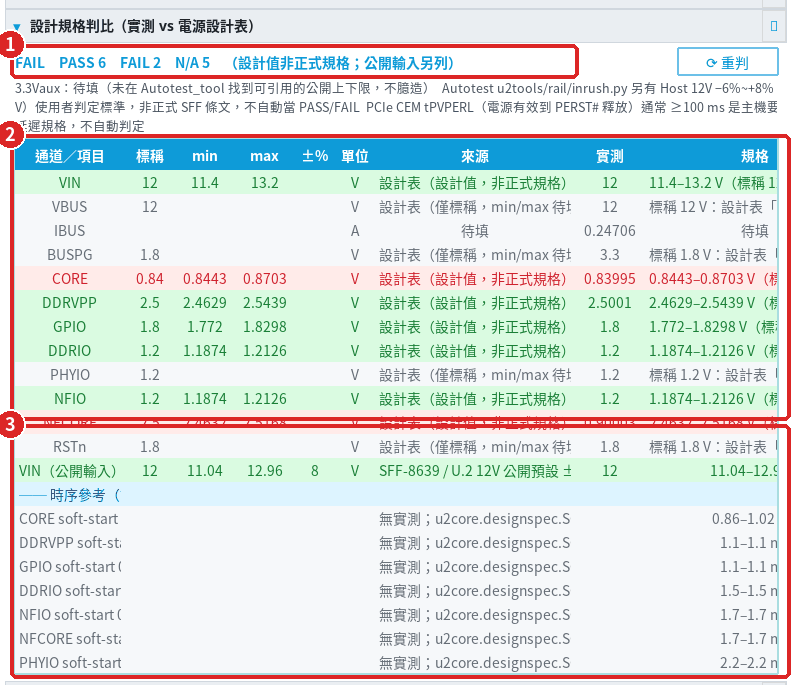

*圖 21　U.2 規格判比*

| 編號 | 位置 | 怎麼看 |
|---|---|---|
| 1 | 總判定 | 例如「FAIL　PASS 6　FAIL 2　N/A 5」。只要有一個 FAIL，總判定就是 FAIL |
| 2 | 判比表 | 每條 rail：標稱、min、max、±%、單位、來源、**實測**、判定。**綠色＝PASS、紅色＝FAIL、灰色＝N/A（設計表沒填上下限，標待填）** |
| 3 | 公開輸入與時序參考 | 「VIN（公開輸入）」是另外列的公開規格（U.2 12 V ±8 %），**不和設計表混在一起**；下面「時序參考」是 soft-start 與 RSTn 的典型值，只做記錄 |

換成 M.2（VIN 3.3 V），按 DUT 規格列的 **M.2** 就好：

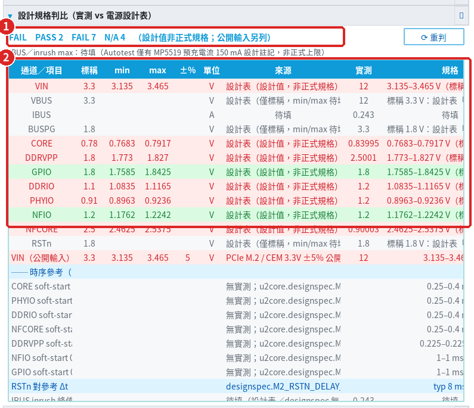

*圖 22　M.2 規格判比*

- 按「**⟳ 重判**」可以用目前的資料重算一次；「編輯…」「另存…」可以改設計表。
- 判定的結果也會寫進 `summary.csv` 的「規格」「電源設計表」「規格總判定」「規格明細」四欄。
- 範例中 CORE、NFCORE 的 FAIL 是因為**示範波形**的標稱（NFCORE 0.9 V）和設計表（NFCORE 2.5 V）不同，實機不會有這個差異。

### 5.11 Linux NVMe 認盤（手動＋自動）

這是**選用功能（預設關閉）**：透過 SSH 連到裝著 DUT 的 Linux 主機，做 PCIe rescan 並讀出碟機資訊，用來確認「上電之後碟有沒有回來」。

**事前準備**：實機 SSH 要先安裝 `pip install paramiko`；Linux 帳號要能不用密碼 `sudo`（rescan 需要 root）。示範模式不用，會用模擬資料。

打開 ⑧ 往下捲，找到「**啟用 Linux NVMe rescan**」區塊。

**A. 手動認盤**

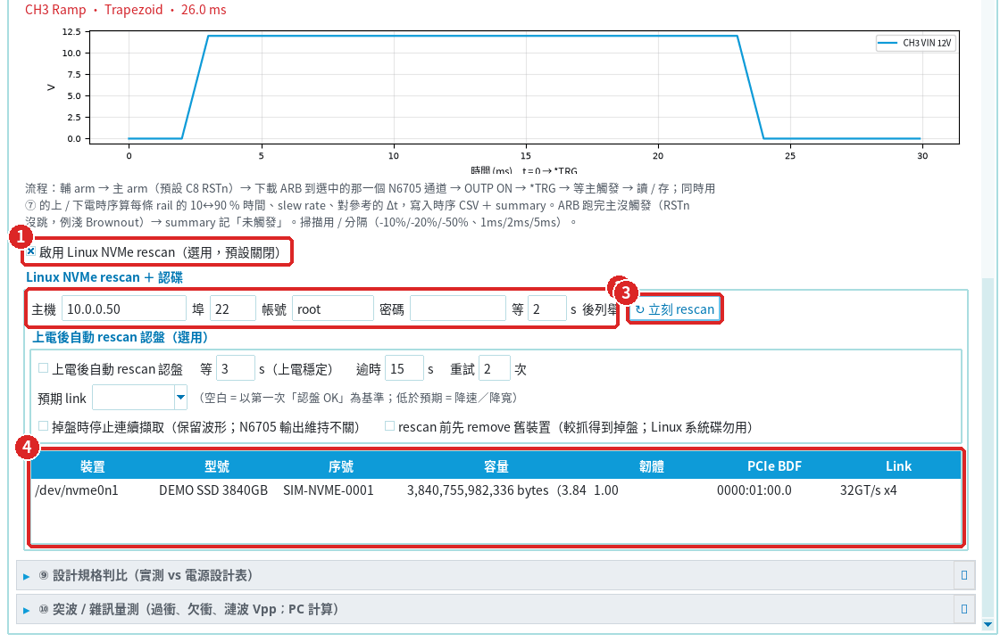

*圖 23　Linux NVMe 手動認盤*

| 編號 | 項目 | 說明 |
|---|---|---|
| 1 | 啟用 Linux NVMe rescan | 勾了才會展開下面的設定，也才會連 SSH |
| 2 | 主機、埠、帳號、密碼、等 N 秒後列舉 | SSH 連線資料 |
| 3 | **↻ 立刻 rescan** | 現在就 rescan 一次並列出碟 |
| 4 | 認盤表 | 裝置、型號、序號、容量、韌體、PCIe BDF、Link（速度與寬度） |

啟用後，① 連線列會多一個 **Linux 主機** 的點，**下面還有一行碟機資訊**（裝置｜型號｜序號｜容量｜韌體｜Link｜判定），這樣不用展開卡片就能看到。

**B. 上電後自動 rescan 認盤（選用，預設關閉）**

勾選「**上電後自動 rescan 認盤**」之後，每次**上電事件**程式會在**背景**自動做：

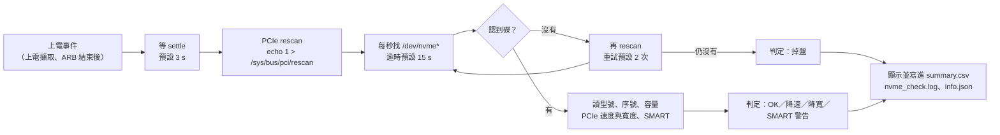

自動認盤的畫面：

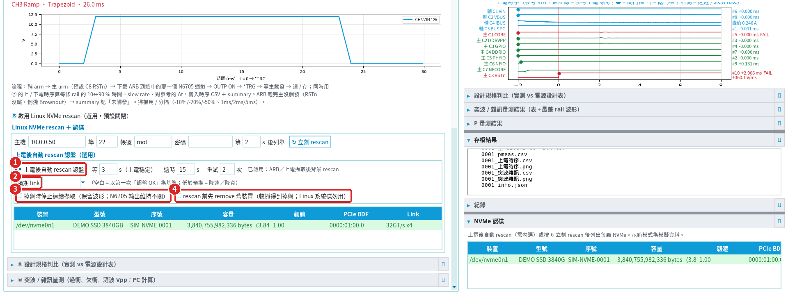

*圖 24　自動認盤設定與結果*

| 編號 | 項目 | 說明 |
|---|---|---|
| 1 | 上電後自動 rescan 認盤 | 勾了就會自動做。**Linux 主機沒填就不能勾** |
| 2 | 預期 link | 填 `Gen4 x4` 這類。**空白＝以第一次認盤 OK 的結果當基準**，之後比基準低就算降速／降寬 |
| 3 | 掉盤時停止連續擷取 | 勾了：掉盤就停，保留這次的波形，**N6705 不關輸出**，現場留給你看 |
| 4 | rescan 前先 remove 舊裝置 | 比較抓得到「上電後沒回來」的碟。**會把該 NVMe 從 Linux 卸除，系統碟不要用** |

**判定結果**

| 判定 | 意思 | 顏色 |
|---|---|---|
| **OK** | 認到碟，link 正常 | 綠 |
| **掉盤** | 沒認到，或比基準少顆 | 紅 |
| **降速／降寬／降速降寬** | 速度或寬度低於預期（或基準） | 黃 |
| **SMART 警告** | `critical_warning` 不是 0 | 黃 |
| **連線失敗** | SSH 本身有問題，**不算掉盤** | — |

何時自動 rescan：

| 情況 | 何時開始 |
|---|---|
| 一般上電擷取（方向判定為上電） | 主機觸發後等 settle |
| ARB Ramp | ARB 跑完後等 settle |
| Brownout margin | ARB 跑完（恢復後）等 settle，連「未觸發」那次也會做 |
| Instant ON-OFF-ON | ARB 跑完（ON 階段）等 settle |

掉盤的樣子（選了「掉盤時停止」）：

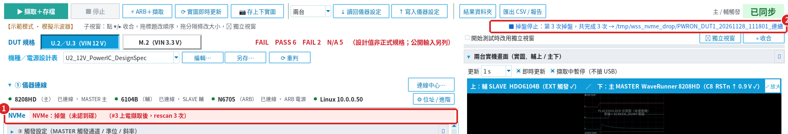

*圖 25　掉盤：停止擷取並保留現場*

| 編號 | 說明 |
|---|---|
| 1 | ① 下面那一行變**紅色**：「NVMe：掉盤（未偵測到）…」 |
| 2 | 右上角訊息：「■ 掉盤，已停止擷取（第 N 次）— 波形已保留；N6705 輸出未關」 |

> **沒勾「自動 rescan」就不會自動認盤**，只剩手動的 ↻。

### 5.12 連續擷取與 USB 斷線

**連續擷取**：在 ⑥ 把觸發次數設成 N（或 0＝一直做），按 ▶ 擷取＋存檔，每一次觸發自動存一組、自動編號。

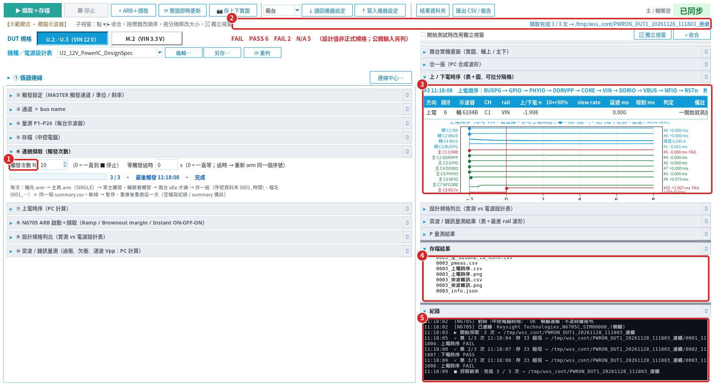

*圖 26　連續擷取完成後（3 / 3 次）*

| 編號 | 說明 |
|---|---|
| 1 | ⑥ 觸發次數 N |
| 2 | 進度：「3 / 3 · 最後觸發 11:18:08 · 完成」 |
| 3 | 最新一次的時序結果（R3） |
| 4 | R7 存檔結果：每次存了哪些檔 |
| 5 | R8 紀錄：每一步的文字紀錄，出問題先看這裡 |

每一次擷取內部做的事：

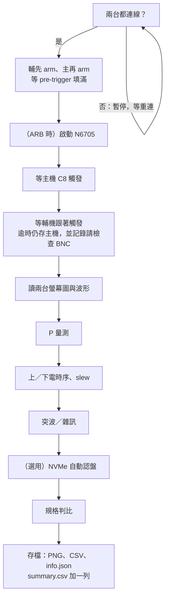

**USB 斷線**：實機偶爾會有 USB 中斷。程式的做法：

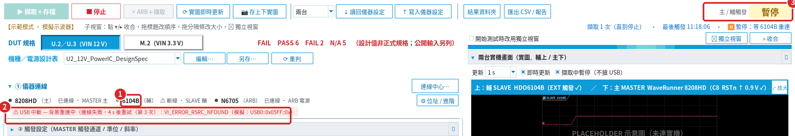

*圖 27　6104B 的 USB 斷線時*

| 編號 | 說明 |
|---|---|
| 1 | ① 的點變**橘／紅**，文字變「斷線」或「連線中」 |
| 2 | 紅字顯示原因，例如「USB 中斷 — 重連失敗（第 3 次）」 |
| 3 | 右上角變成「**暫停**」，並顯示「暫停：等 6104B 重連」 |

- 程式在背景**自動重連**，間隔 1 → 2 → 4 → 8 → 15 → 30 秒。
- 連續擷取中斷線會**暫停**；重連成功後**重做那一次**，空檔會記在紀錄與 `summary.csv` 的備註。
- 重連後，程式會先重做對時與 Auto scale。你不用重開程式。
- 閒置時每 3 秒做一次心跳檢查。

### 5.13 面板收合、拖移與版面

左邊 ① 到 ⑩、右邊 R1 到 R8，**每個面板都可以收合、手動拖移、拉大小、獨立成視窗**。

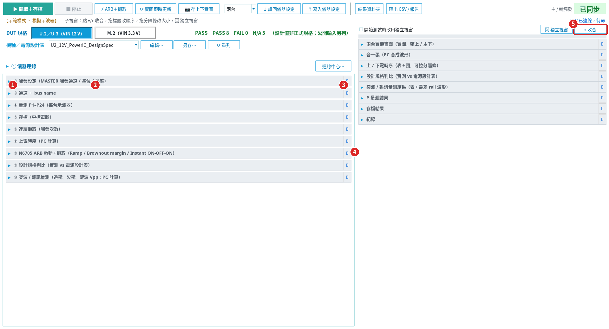

*圖 28　全部收合後的畫面與操作位置*

| 編號 | 動作 | 怎麼做 |
|---|---|---|
| 1 | **收合／展開** | 點標題最左邊的 **▾／▸** |
| 2 | **改順序** | 按住標題列拖到想要的位置 |
| 3 | **獨立視窗** | 點標題右邊的 **⧉**，面板變成單獨的視窗（可放到第二螢幕）；關掉視窗就回來 |
| 4 | **改大小** | 拖左右欄中間、或面板之間的**分隔條** |
| 5 | **» 收合右欄** | 把整個右邊結果區收起來，左邊設定區變寬；另有「⧉ 獨立視窗」把整個右欄拆出去 |

- 勾「**開始測試時改用獨立視窗**」，按 ▶ 後結果會自動開到獨立視窗。
- 你調過的版面（誰收合、順序、分隔條位置）會**自動記住**，下次開啟還原。記在 `%APPDATA%\scope_wave_saver\ui_layout.json`。
- 版面亂掉了？**關掉程式，刪除 `ui_layout.json`**，下次開啟就是預設版面。也可以用環境變數 `SCOPE_UI_LAYOUT` 指定別的檔案。

---

## 6. 輸出檔案說明

### 6.1 資料夾結構

預設在 `桌面\scope waveform\`。每按一次 ▶ 擷取＋存檔，就開一個新的執行資料夾：

```text
scope waveform\
└─ PWRON_DUT1_20261128_111330_連續\          ← 這次執行（觸發次數 = 1 時沒有「_連續」）
   ├─ summary.csv                            ← 每次擷取一列的總表（最重要）
   ├─ nvme_check.log                         ← 自動認盤紀錄（有啟用才有）
   ├─ 0001_111331\                           ← 第 1 次（序號_觸發時間）
   │  ├─ 0001_畫面_上下.png                  ← 輔上／主下，無縫接合的一張圖
   │  ├─ 0001_輔_6104B_實圖.png              ← 輔機原始螢幕圖
   │  ├─ 0001_主_8208HD_實圖.png             ← 主機原始螢幕圖
   │  ├─ 0001_輔_6104B_C1_VIN.csv/.trc       ← 各通道波形（時間, 電壓）／原始檔
   │  ├─ 0001_主_8208HD_C8_RSTn.csv/.trc     ← …（共 12 條通道）
   │  ├─ 0001_上電時序.csv／.png             ← 上電時序表與圖（下電時是「下電時序」）
   │  ├─ 0001_突波雜訊.csv／.png             ← 突波／雜訊表與標好標記的圖
   │  ├─ 0001_pmeas.csv                      ← P 量測（示波器值與 PC 值）
   │  └─ 0001_info.json                      ← 這次的儀器、觸發、判定、NVMe 結果
   └─ 0002_111333\ …                         ← 第 2 次
```

> 實際會存哪些檔案，看 ⑤ 的格式勾選。單次擷取（N＝1）沒有「_連續」字樣。擷取過程的文字紀錄另外寫在 `桌面\scope waveform\scope_wave_saver.log`。

### 6.2 檔案用途一覽

| 檔案 | 內容 | 什麼時候看 |
|---|---|---|
| `summary.csv` | 每次擷取一列：序號、時間、方向、時序判定、順序、規格判定、NVMe、各 rail 延遲／10–90 %／slew、突波雜訊、P 值 | **整批結果先看這個**，用 Excel 開 |
| `畫面_上下.png` | 輔機畫面在上、主機畫面在下 | 貼報告 |
| `*_上電時序.csv`／`*_下電時序.csv` | 時序表（見 6.3） | 要數字時 |
| `*_上電時序.png` | 時序圖 | 貼報告 |
| `*_突波雜訊.csv`／`.png` | 突波雜訊表與圖（見 6.4） | 看過衝、漣波 |
| `*_pmeas.csv` | P 量測 | 交叉比對 |
| `*_Cn_名稱.csv`／`.trc` | 各通道原始波形 | 自己用其他工具畫圖 |
| `*_info.json` | 這次的設定與判定摘要 | 追溯 |
| `nvme_check.log` | 每次自動認盤的結果 | 查掉盤 |

### 6.3 summary.csv 欄位

大致由左到右分成這幾組（沒啟用的功能，那一組欄位不會出現）：

| 組別 | 欄位 |
|---|---|
| 基本 | 序號、觸發時間、方向（上電／下電）、輔觸發（Y／N）、時序判定、順序、檔案數、資料夾、備註 |
| 規格 | 規格、電源設計表、規格總判定、規格明細 |
| ARB（用 ARB 才有） | ARB 通道、ARB 範本、ARB 掃描值、ARB 參數 |
| NVMe（啟用自動認盤才有） | NVMe 數、裝置、型號、序號、容量、韌體、BDF、Link、判定、速度、寬度、SMART、嘗試、說明、觸發 |
| 時序 | 每條 rail 的「延遲 ms」「10-90 % ms」「slew V/ms」（欄名前面有「輔」或「主」，例如 `輔VIN 延遲 ms`、`主CORE slew V/ms`） |
| 突波／雜訊（啟用才有） | 突波雜訊判定；每條 rail 的過衝 %、欠衝 %、漣波 Vpp |
| P 量測 | 例如 `6104B P1 MAX C1`、`8208HD P17 RISE C1 10-90%` |

> 欄位順序也遵守「輔機在前」：VIN、VBUS、IBUS、BUSPG，接著 CORE … RSTn。
> ARB 時，沒觸發的那次也會有一列，「備註」寫「未觸發」。

### 6.4 突波雜訊.csv 欄位

示波器、CH、rail、類型（電源／電流 A）、穩態 Vss、過衝 V／%、欠衝 V／%、漣波 Vpp／%、RMS 雜訊、單位、窗口起／迄 ms、窗口位置、頻寬限制、過衝限／欠衝限／漣波限（%）、漣波限 mV、**限值來源**（使用者／設計表／預設（待確認））、**判定**（PASS／FAIL／N/A）、備註。

### 6.5 其他檔案

- **`nvme_check.log`**：每次認盤一段，以 Tab 分隔：時間、序號 `#N`、階段（上電擷取後／ARB 結束後…）、判定（OK／掉盤…）、說明、link、SMART、嘗試次數，下一行是碟機細節（裝置、型號、序號、容量、韌體、BDF、Link）。
- **`info.json`**：序號、時間、輔機是否觸發、兩台儀器的 IDN、觸發設定、通道名稱、時序判定；ARB 時有 `arb`，認盤時有 `nvme`。

---

## 7. 常見問題與排除

**Q1. 開程式就跳「需要 All in Test tool 的 u2core（設 U2_TOOL_DIR）」。**
找不到 Autotest_tool。先 `set U2_TOOL_DIR=你的 Autotest_tool 路徑` 再執行 `run.bat`。

**Q2. 左上角有橘色「示範模式」，波形看起來是假的。**
你是用預設（示範）啟動的。要接實機請用 `run.bat --real`。

**Q3. ① 的點是灰色或紅色，連不上。**
依序檢查：USB 線、儀器電源、有沒有別的軟體（例如另一個 VISA 程式）佔住儀器、`⚙ 位址／進階` 的 VISA 位址對不對。程式會自動重連，等幾十秒通常就好。

**Q4. 一直「等主觸發」，沒有擷取。**
檢查：主機 C8 有沒有接到 RSTn；② 的準位（預設 0.9 V）和斜率（上電 Rising、下電 Falling）對不對；DUT 有沒有真的上電或下電。ARB 時逾時＝ARB 長度加 1 秒。

**Q5. 擷取了，但備註寫「輔未觸發」。**
主機有觸發、輔機沒有。檢查 **主 Aux Out → 輔 EXT 的 BNC** 有沒有接好、輔機有沒有 arm。程式仍會存主機的波形。

**Q6. 時序表出現「一開始就高於門檻」。**
觸發時那條 rail 已經在高準位，或時間窗沒涵蓋到上升。把 ② 的 Delay 設更負（例如 −8 ms）或加大 T/div，讓波形涵蓋上升的過程。

**Q7. 規格表有「待填」「N/A」。**
設計表沒有填那條 rail 的上下限（例如 U.2 的 VBUS、BUSPG、RSTn、IBUS），所以不判。要判就在「編輯…」補上數值。

**Q8. 突波雜訊出現 FAIL，但規格總判定沒變。**
預設限值（5 %／5 %／2 %）是暫定值，預設不計入總判定。要計入請在 ⑩ 勾「預設限值也計入」，或填正式限值。

**Q9. ARB 說「未觸發」是不是壞了？**
不是。Brownout 掉得不夠深、DUT 沒 reset，RSTn 不動，就是未觸發。這是量測結果。

**Q10. NVMe 認盤顯示「連線失敗」。**
SSH 問題：主機位址、帳號、密碼、`paramiko` 有沒有安裝、`sudo` 是否免密碼。連線失敗**不算掉盤**。exe 版不支援實機 SSH，請用 `run.bat`。

**Q11. NVMe 顯示「掉盤」。**
上電後沒有認到碟。看 `nvme_check.log` 與 `info.json` 的細節。可以先不勾「rescan 前先 remove」，避免誤卸除系統碟。

**Q12. 畫面版面亂掉、視窗太大或太小。**
關閉程式，刪除 `%APPDATA%\scope_wave_saver\ui_layout.json`，重新開啟。建議螢幕解析度 1920×1080。

**Q13. 示範模式的 CORE、NFCORE 規格判定是 FAIL。**
示範波形的標稱電壓與設計表不同（NFCORE：示範 0.9 V，設計表 2.5 V），示範特有現象，不影響實機。

**Q14. 「⟳ 實圖即時更新」「結果資料夾」「匯出 CSV／報告」按了沒反應。**
這三個按鈕目前是保留位置，還沒接功能。看即時畫面請用右欄 R1 的「更新」與「即時更新」；結果請直接開存檔資料夾，每次擷取已自動存 CSV。

**Q15. 按 ■ 停止之後，N6705 的輸出會怎樣？**
程式會中止 ARB 波形，並依 ⑧「結束／停止 →」的設定：**輸出 OFF** 或**維持最後電壓**。自動認盤掉盤並勾了「掉盤時停止」時，**輸出一律不關**，現場留給你。

**Q16. 我想把整批結果給別人看。**
把整個執行資料夾壓縮（例如 `PWRON_DUT1_日期時間_連續`）。其中 `summary.csv` 是總表，各序號資料夾有圖與原始波形。

---

## 8. 附錄：按鈕速查與示範旗標

### 8.1 按鈕速查

| 我想要… | 按這裡 |
|---|---|
| 一般上電／下電擷取 | 工具列 **▶ 擷取＋存檔** |
| 用 N6705 自動掉電或開關並擷取 | ⑧ 選模板 → **⚡ ARB 啟動＋擷取** |
| 停止 | **■ 停止**；ARB 另有 **⛔ N6705 安全中止** |
| 換 DUT 機種 | 最上方 **U.2／U.3**、**M.2** |
| 改觸發 | ② → **套用觸發到兩台** |
| 把名稱寫進示波器 | ③ → **⤒ 寫入 bus name** |
| 填好常用 P 量測 | ④ → **預設（每 CH MAX／MIN）** |
| 改存檔位置 | ⑤ 的「存到」→ **…** |
| 一次擷取很多次 | ⑥ 的觸發次數 N |
| 看時序、slew、判定 | 右欄 R3「上／下電時序」 |
| 看過衝、漣波 | 右欄 R5「突波／雜訊量測結果」 |
| 看規格 PASS／FAIL | 右欄 R4「設計規格判比」 |
| 立刻認盤 | ⑧ 的 Linux 區 → **↻ 立刻 rescan** |
| 重算規格或突波 | ⑨「⟳ 重判」、⑩「⟳ 重算」 |
| 把版面還原 | 關程式、刪 `ui_layout.json` |

### 8.2 啟動旗標

| 旗標 | 說明 |
|---|---|
| `--real` | 接實機（預設是示範模式） |
| `--view stack｜merge｜seq` | 開在上下實圖、合一張、上／下電時序 |
| `--capture N` | 啟動後自動擷取 N 次（0＝直到停止） |
| `--arb N`、`--arb-tpl RAMP｜BROWNOUT｜ONOFFON`、`--arb-ch 1｜3` | 啟動後自動 ARB（示範／測試） |
| `--form U2｜M2`、`--profile <名稱>` | 預設 DUT 規格與設計表 |
| `--nvme`、`--nvme-auto` | 啟用 Linux NVMe（示範為模擬資料）；`--nvme-auto` 並勾自動 rescan |
| `--folder <資料夾>` | 存檔位置 |
| `--layout <檔或 ->` | 版面檔；`-`＝不讀不寫 |

### 8.3 重新產生本手冊的截圖與 PDF（維護者用）

手冊的截圖用示範模式在 xvfb（1920×1080）自動產生，之後畫面改了可以重做：

```bash
export U2_TOOL_DIR=/path/to/Autotest_tool
python3 docs/make_images.py all      # 截圖 → docs/img/
python3 docs/build_pdf.py            # 產生 docs/操作手冊.pdf（需 Chrome、mermaid-cli、Noto Sans CJK）
```
